# Credential Verification Portal — Weeks 1–3 + extras rounds 1–9 + hardening U12–U19

A browser-accessible verification portal for the Gef26 private credential
chain. A verifier uploads (or pastes) a credential — JSON **or a portal-issued
diploma PDF** — and the portal runs the chain's six checks and shows a verdict.
No Python, no notebook, no blockchain knowledge required.

What's in the box, per the 3-week plan:

- **Week 1** — the portal: plain HTML + fetch UI, issue / revoke / verify /
  status endpoints, six-check verdicts (VALID / REVOKED / INVALID / NOT FOUND).
- **Week 2** — RAG chat: MiniLM-L6-v2 + FAISS retrieval, DeepSeek / Ollama /
  offline generator, answers with cited sources.
- **Week 3** — hardening (rate limiting, input guards, corrupted-chain
  handling), deployment configs (Render / Railway), README, demo video.
- **Extras round 1** — QR codes, public (anonymized) log, anomaly watch.
- **Extras round 2** — verifiable diploma PDFs, real IsolationForest anomaly
  detection, persistent log, multi-signer admin, email notifications, and a
  full visual/mobile polish pass. (The original "student self-service lookup"
  from this round was replaced by holder links in U12 — see below.)
- **U12 (2026-11)** — role and entry-point separation: `/` public, `/me/<link>`
  holder, `/staff` staff console behind a token login; signed holder links
  replace the StudentID + DOB lookup; notifications become queued events with
  a fixed recipient; a PII-free holder index lets the bundle ship without
  `rawjsondocs/`. See `docs/U12_role_ux_plan_radical.md`.
- **U13–U18 (2026-11, hardening)** — a hash is a lookup key, not a credential:
  the public PDF becomes a report with withheld identity, staff surfaces move
  behind sessions, login/global throttles share one IP rule, chain integrity
  is surfaced on `/healthz`, `/api/version` and the public page, signers can be
  retired with a trust window, and the revocation status list became
  **offline-verifiable** (`gef26.statuslist.v2` + `GET /api/signers/keys` +
  `scripts/verify_statuslist.py`, with `--expect` for an out-of-band
  fingerprint and `--pin` for TOFU). Docs: `docs/U13…U18`.
- **U19 (truthful surface)** — `GET /api/diagnostics` (staff) returns the *text*
  behind `/healthz`'s counts; every PDF prints `CHAIN INTEGRITY FAILED` when the
  chain is broken; and the PDF's QR is actually drawn for the first time —
  `drawImage` had rejected a `BytesIO`, and the `TypeError` was swallowed by
  `except ... pass`, so six rounds of notes described a QR that never existed.
  Now `ImageReader`, plus a printed-URL fallback and two tests. Docs:
  `docs/U19_truthful_surface.md`.
- **U20 (pin rotation)** — U18's strict pin had no legitimate way to follow a
  key rotation except deleting the file (the very reset it was meant to block).
  `--pin-update` records the rotation: only when the list verifies, into a
  v2 pin with an append-only `history` of old/new fingerprint sets and UTC
  timestamps, and it warns when no `--expect` was supplied. Docs:
  `docs/U20_pin_rotation.md`.
- **U21 (PDF layout as data)** — every position on the diploma card now lives in
  one `LAYOUT` table with `layout_zones` / `layout_conflicts`, so "does the QR
  collide with the revocation band" is an assertion instead of an eyeball
  review. Over-long fields are explicitly **truncated** with a note (full values
  stay in the embedded JSON) rather than pushing the hash box, QR and red bands
  off the page; the QR degrades 28mm → 20mm → printed URL. Also fixed the
  second hash row printing **outside** the grey box. Docs:
  `docs/U21_pdf_layout.md`.
- **U22 (text fitted by width)** — every single-line string is now measured,
  not cut by character count: `IssuingO[:44]` was ~150mm for Latin text and
  ~310mm for 44 CJK glyphs on a 210mm page. `_fit_text` binary-searches the
  longest prefix that fits and appends `...`; `_wrap_text` hard-breaks a token
  wider than the column (a 300-character ID, a URL); the constant footer
  sentences are measured too, so editing a sentence fails a test instead of
  leaving the page. Docs: `docs/U22_text_fit.md`.
- **U23 (honest caching)** — the integrity verdict is cached for 30 s, so both
  `/healthz` and `/api/diagnostics` now carry `checked_at` + `age_s`; a cache
  hit keeps the original timestamp (refreshing it on read would make the field
  always read `0.0`). A verdict whose scan outlasts its TTL is no longer stored
  at all — it used to be cached already-expired, i.e. never readable. The
  chain-cache test's TTL went from 0.05 s (same order as one scan, hence flaky)
  to 0.5 s, and `test_restart_persistence` now fails fast when the spawned
  uvicorn dies and prints its log tail instead of hiding it. `smoke_portal.py`
  grew to **20** checks: diagnostics anonymous/authenticated, the integrity age,
  and **the PDF actually containing an embedded image** — the operational guard
  for the U19 QR failure. Docs: `docs/U23_integrity_age.md`.
- **U24 (who is the client)** — `X-Forwarded-For` used to be believed
  unconditionally, so on an instance with no proxy in front, a rotating forged
  header produced a fresh rate-limit bucket per request (nine forged sign-ins
  were measured, none locked). The header is now read only when the direct peer
  is in `TRUSTED_PROXIES` (default empty), and the address taken is the nearest
  hop that is not itself a trusted proxy. Then the second layer showed up:
  uvicorn's default `--proxy-headers` rewrites the peer before the app runs, so
  every launch line now passes `--no-proxy-headers` — with a real proxy, set
  `--forwarded-allow-ips` *and* `TRUSTED_PROXIES` to the same address.
  `/healthz` says `client_ip_source`, `whoami` echoes the bucket key, and
  `smoke_portal.py` probes a forged header (**22** checks). Docs:
  `docs/U24_proxy_trust.md`.
- **U25 (one screen, three fields)** — the landing page was a five-tab console
  asking a stranger to choose a role before it would do anything. It is now a
  single question — 这张证书是真的吗？ — with one input (paste the hash *or*
  pick a PDF), one button, and one sentence back. The six checks are still
  there, folded under 「为什么」, and the old console moved to `/portal` (no
  route removed). The issuing side got its own page, `/issue`: three fields
  (name / student id / degree), one button, and the result is a hash, a PDF and
  a `/verify?hash=…` link that closes the loop in one click. The form posts to
  the same guarded `POST /api/custom/build`; the token box only appears when
  there is no staff session. New tests pin the shape (no inline markup, no
  `innerHTML`, exactly three `required` fields); the frontend module is **27**
  tests. Docs: `docs/U25_one_screen.md`.
- **U26 (reachable, and watchable)** — a demo on `127.0.0.1` is a demo nobody
  can join. `start_showcase.bat` boots the portal, opens a Cloudflare quick
  tunnel (with the 429 retry that quick tunnels need), starts the app with
  `PUBLIC_BASE_URL` set to that tunnel and `TRUSTED_PROXIES=127.0.0.1` so the
  limiter keys on real visitors, then opens `/showtime`. That page is the
  stage: issue → verify → revoke → verify again, four steps, ~12 s, every
  step a real API call, ending on 「签名仍然有效，失效的是机构的承诺」 with a
  scannable QR. The first public run exposed a real bug: the cross-origin
  guard only accepted `127.0.0.1/localhost`, so every POST from the tunneled
  page was 403 even with a valid token — `_origin_allowed()` now compares
  against the request's own `Host`. `test_hardening` is **11** tests. Docs:
  `docs/U26_showcase.md`.
- **U27 (the screen a judge actually sees)** — an audit at 1440×900 found the
  page rendering as a 560 px phone card, the verdict below the fold, and three
  places where the UI said something false: `/showtime` told the presenter to
  press the button 右下角 when it sits bottom-left; a revoked credential printed
  `原因：DEMO SAMPLE: issued by mistake。`; the step row claimed `VALID · 2.4s`
  for a call that took 10 ms (the number included a pacing sleep). The verify
  page is now desktop-first (900 px card at ≥900 px, form folds away after a
  verdict), and carries a 「这次查验做了什么」 strip built from the response
  itself — block numbers, issue time, signature check, hash compare, revocation
  lookup, chain height from `/healthz`, and a real `fetch` duration. The stage
  page gives each of its four steps a receipt (`第 18 块 · 127 ms`) and writes
  a Chinese revocation reason. Docs: `docs/U27_ui_pass.md`.
- **U28 (one voice: Traditional)** — the product spoke Simplified
  (`这张证书是真的吗`) while the poster, the deck and the audience were
  Traditional; a Hong Kong judge read two different products. All served pages
  moved to Hong Kong Traditional — 2,664 characters across 16 files — via
  `scripts/to_traditional.py` (opencc `s2hk`, plus 連結 / 裡 / 預設), the `<html
  lang>` went from `zh-CN` to `zh-Hant-HK`, and two server strings a user can
  actually see were converted with it. Only CJK runs are rewritten, so no tag,
  identifier or byte of code moved; the script is idempotent and has a
  `--check` mode. Tests that pinned the old copy (2 in `test_frontend`, 2 in
  the JS harness) moved with it. Docs: `docs/U28_traditional_copy.md`.
- **U29 (the booth fallback)** — `demo-media/GEF-mobile-stage-run.mp4` is one real
  four-step run (21.9 s, silent), filmed headless through DevTools so nothing on
  the presenter's desktop can leak into frame. `demo-media/GEF-mobile-walkthrough.mp4`
  is the captioned cut (67.8 s): home → valid → revoked → issuance → stage, all in
  one tab, so the heights rise 47 → 48 → 50 as they really did. Captions are
  burned in rather than narrated — a visitor reads them, and text cannot drift out
  of sync. The poster's fourth figure became `0 / 上鏈的姓名與成績 PII ON CHAIN`,
  a property of the design instead of a block count that every rehearsal moved.
  Docs: `docs/U29_recording.md`.
- **Pre-flight** — `python scripts/preflight.py` checks the eleven things that fail
  silently ten minutes before a booth opens: the app answers, the demo credential
  is still VALID, the revoked sample is still REVOKED, the public tunnel reaches
  *this* instance, the code the stage page draws still scans to that public address, the
  seven deliverables are on disk, both videos have no audio
  and a sane length, the poster's QR codes still decode to the YouTube and GitHub
  URLs, the served copy is Traditional with nothing pending, the A0 PDF is really A0 at 150 dpi with margins and readable QR codes,
  and the submission zip is current. `--tests` adds the full suite. `start_showcase.ps1` now runs it as its
  last step, so a green launcher means a ready booth.
- **Stage QR, actually readable** — pre-flight kept failing on one item: the code the
  stage page draws was a 200 OK PNG that no detector could read. The cause was not
  size. `qrcode.make()` picks its mask by its own penalty rules, and for the current
  161-character public URL that mask is one OpenCV rejects outright (610×610, 732×732,
  same result), while the identical payload with mask 3 decodes first time. `/api/qr/{hash}`
  now builds the code explicitly — `ERROR_CORRECT_M`, `box_size=10`, `border=4` — and walks
  the eight masks until a detector reads the URL back, falling back to mask 3 where OpenCV
  is not installed. Verified end to end: the served PNG decodes to
  `…/verify?hash=…`, and pre-flight is 11/11.
- **Extras round 3** — *person in context*: the AI resolves who you're asking
  about into a masked profile card, keeps that person across follow-ups
  ("what degree does he hold?"), and can search the web for public info about
  that person (Wikipedia / DuckDuckGo), clearly labeled as web results and
  never mixed with chain facts.
- **Extras round 5** — **public verifier mode** (`PUBLIC_MODE=1`): the deployed
  URL verifies but cannot issue/revoke (admin endpoints 403, admin tabs
  hidden), `/api/version`, one-click VALID / REVOKED / NOT-FOUND samples, and a
  downloadable **verdict receipt** (receipt ID, six checks, verifier version,
  chain snapshot, disclaimer — no DOB).
- **Extras round 6 (employer pack)** — **batch verify** (API + CLI + CSV
  results), **public API keys** with per-key rate limits, a **signed
  revocation status list** (OCSP-like, ETag-cacheable), a **receipt registry**
  (`/api/receipt/{id}`), and revocation **reason / effective date** recorded
  on-chain and surfaced on verdicts.
- **Extras round 7 (persistence)** — `scripts/backup_chain.py` export/import
  and `CHAIN_SNAPSHOT_URL` boot-restore so a free-tier restart does not lose
  issued credentials.
- **Extras round 8 (UX)** — the UI is now built for non-developers: a role-based
  landing page (验证 / 学生 / 管理员), drag-and-drop PDF/JSON verification,
  plain-language verdicts (真实有效 / 已注销 / 查无此证 / 无效), collapsible
  six checks, a registrar **batch-issue wizard** (CSV → preview → one-click
  issue → per-row PDF/QR), student share links, friendlier errors, bilingual
  labels, and one-click launchers (`start_portal.bat` / `start_portal.sh`).
- **Extras round 9 (PDF auto-fill)** — upload a certificate PDF and the portal
  auto-fills the credential JSON form: portal-issued PDFs are extracted
  byte-exact from the embedded payload (`mode=embedded_payload`, confidence
  1.0); text-layer electronic certificates get label-aware field extraction
  with per-field confidence + warnings (`mode=text_extract`). Extraction is
  input assistance only — it never bypasses the six cryptographic checks, and
  the user always reviews and clicks Verify. Endpoint: `POST /api/extract/pdf`.

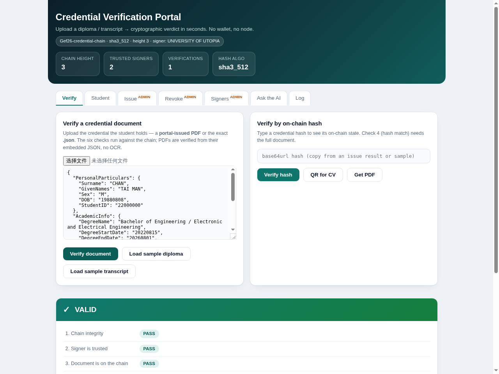

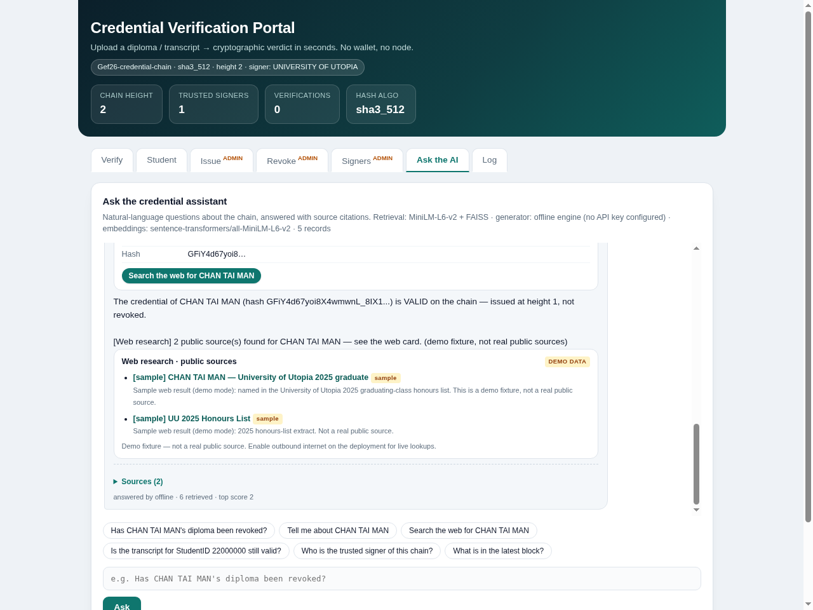

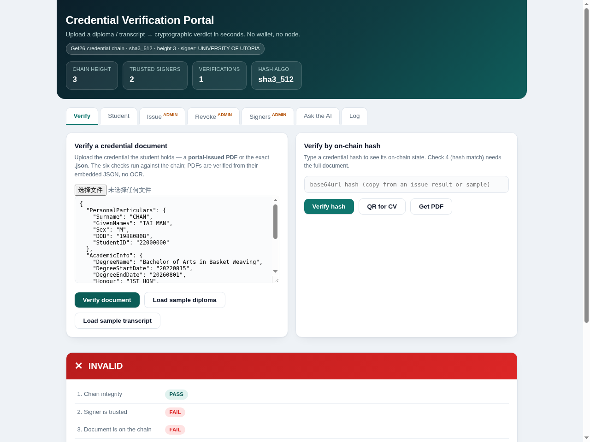

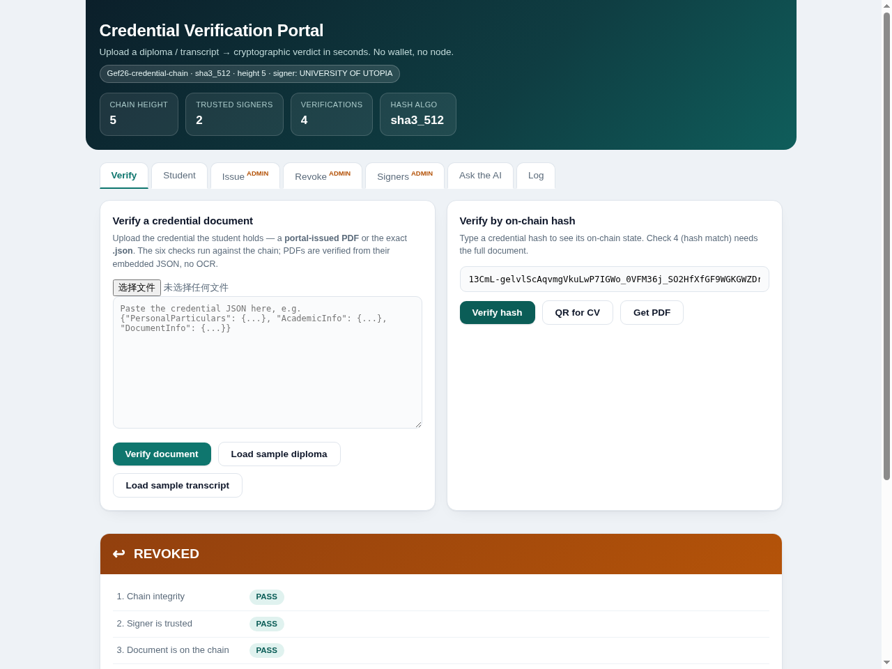

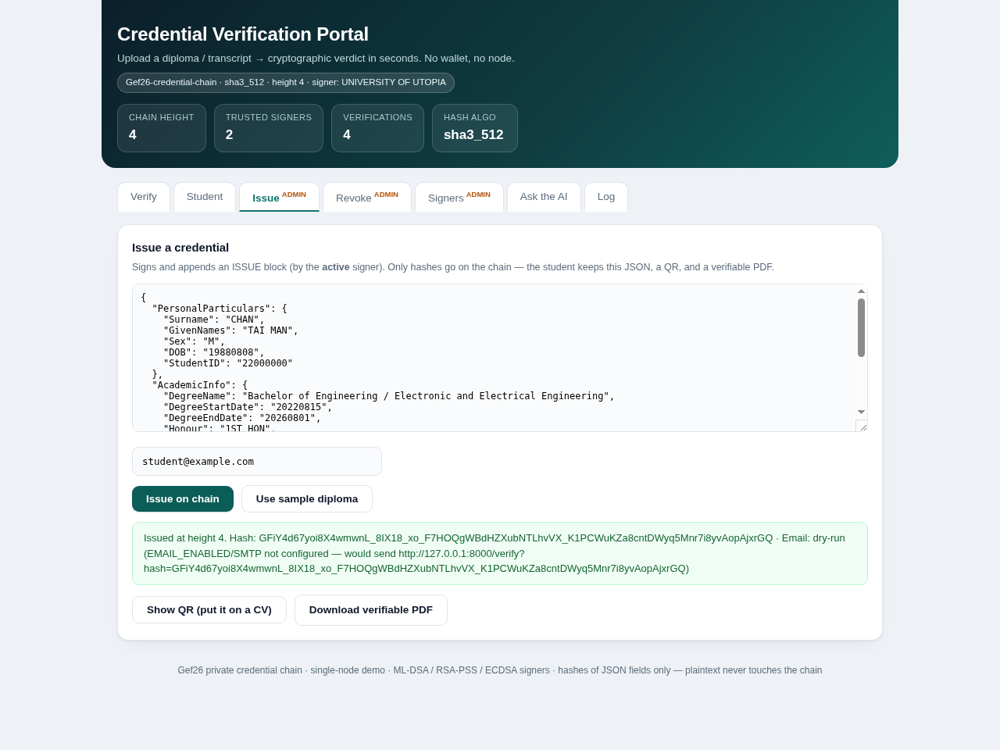

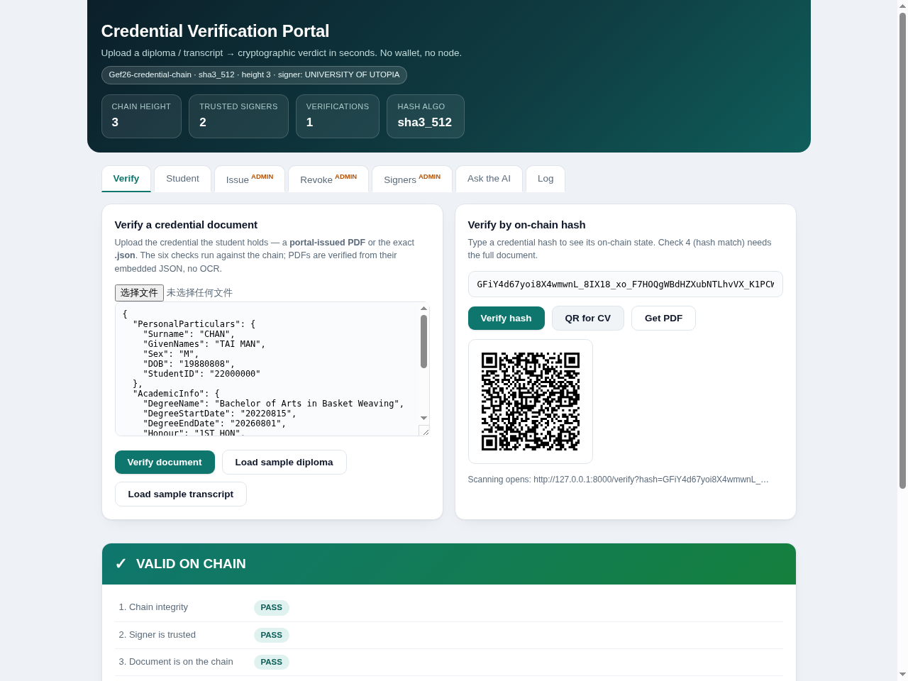

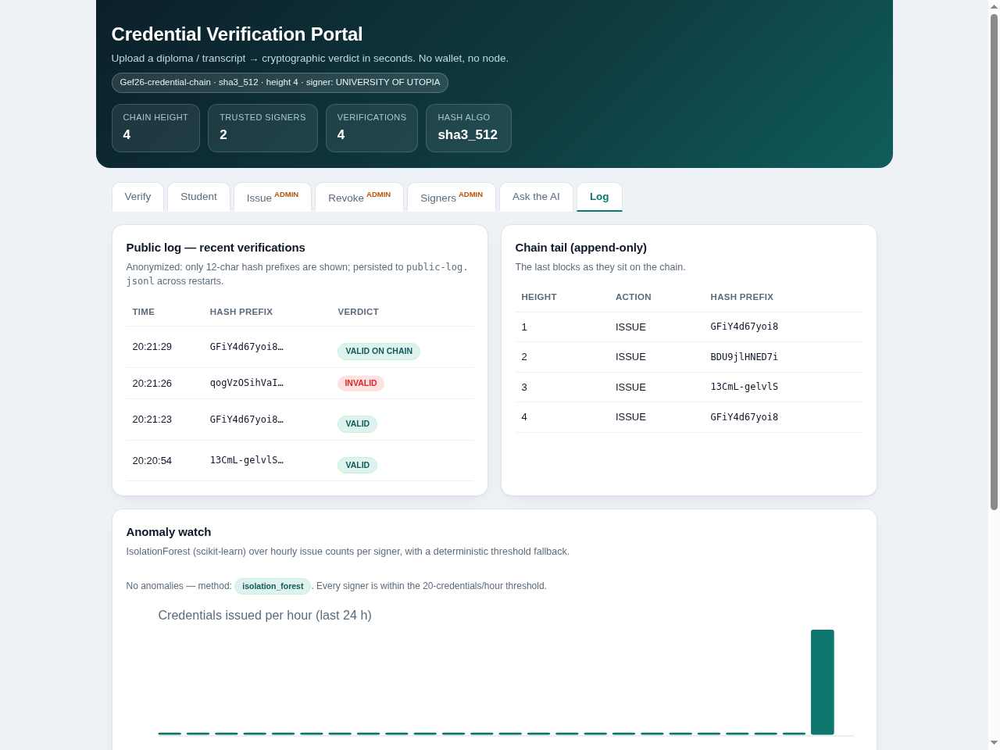


> Screenshots from here down predate the U12 split and are kept as a
> before/after record, not as current UI: they were taken when all nine tabs
> lived in one page. The behaviour they show (verify, QR, log, issuing) still
> exists, but issuing, revocation and signer management now live behind
> `/staff`, and the StudentID + DOB form has been replaced by holder links.
> The demo video has been rebuilt on top of the current screenshots.

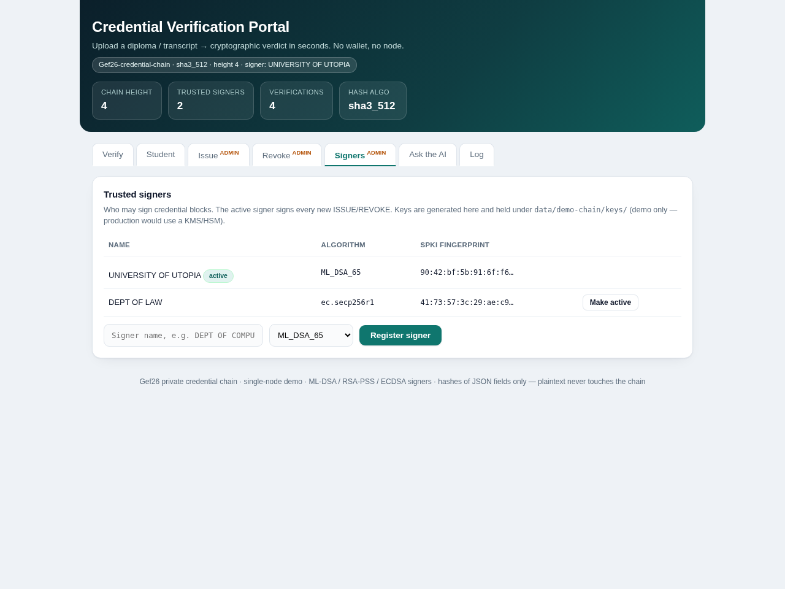

**Demo video:** [`demo.mp4`](demo.mp4) — two-minute walkthrough in the U12 order:
public entry → upload → VALID, tamper → INVALID, revoke → REVOKED, holder link
→ one credential only, staff sign-in → issue + holder link, QR → verdict, ask
the AI → cited answer, public log. Rebuild with
`.venv/bin/python scripts/build_demo_video.py` (needs `ffmpeg` on PATH); the
script stitches `docs/screenshot-*.png`, so refreshing a screenshot refreshes
the video.

---

## Quick start

**One click (Windows):** double-click `start_portal.bat` — it creates the
virtualenv, installs dependencies on first run, starts the server and opens
the portal in your browser. macOS/Linux: `./start_portal.sh`. Both default to
private mode (issuing enabled); flip `PUBLIC_MODE=1` in the launcher for a
verification-only public instance.

```bash
cd verification-portal

# optional but recommended: ML stack in a project venv (CPU torch)
python3 -m venv --system-site-packages .venv
.venv/bin/pip install torch --index-url https://download.pytorch.org/whl/cpu
.venv/bin/pip install -r requirements.txt

# run (use `.venv/bin/python -m` if you made the venv). `--no-proxy-headers`
# is mandatory: uvicorn otherwise rewrites the caller address from
# X-Forwarded-For (it trusts 127.0.0.1 by default), which bypasses the app's
# own TRUSTED_PROXIES check — see docs/U24_proxy_trust.md.
uvicorn app.main:app --host 127.0.0.1 --port 8000 --no-proxy-headers
```

Open **http://127.0.0.1:8000** — the chain is created and seeded on first
startup (a trusted ML-DSA_65 signer + two sample credentials: a diploma and a
transcript).

The UI is split into **three entry points**, not one page with nine tabs
(U12). A visitor only ever downloads the code for the role they are in:

| Entry | Who | What it can do |
| --- | --- | --- |
| `/` | anyone | verify a credential, read the public log, ask the assistant, open a holder link |
| `/me/<link>` | one holder, via a signed link | see that one credential and its live status |
| `/staff` | school staff, behind a token login | issue, revoke, manage signers and API keys |

`/staff` asks for the staff token once and keeps it server-side in an
HttpOnly cookie; the token is not written to `localStorage` or into the page.
On a deployment with no staff token configured, `/staff` answers 404 — the
route does not advertise itself.

The three entries, captured after U12 (the older screenshots further down are
from the single-page build):

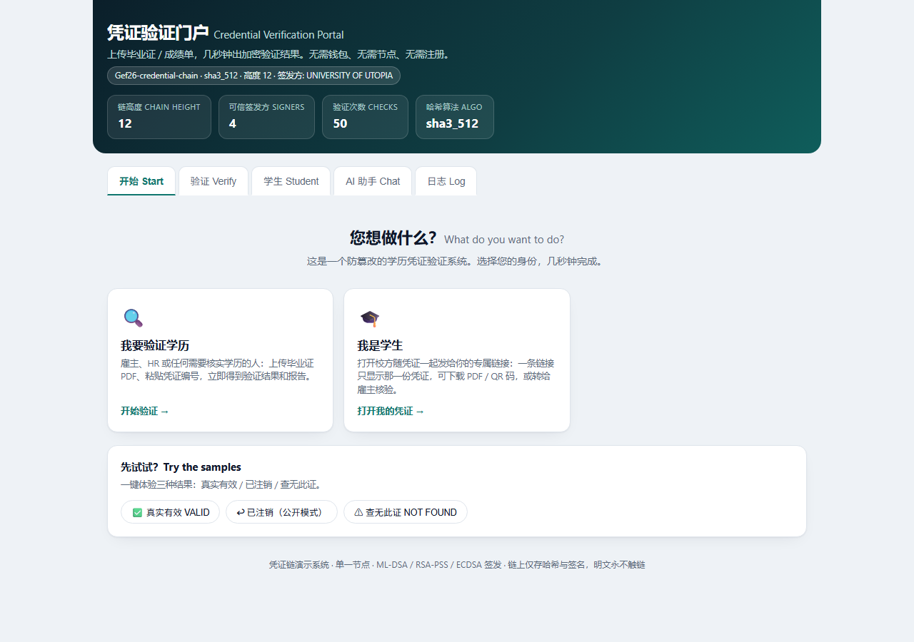

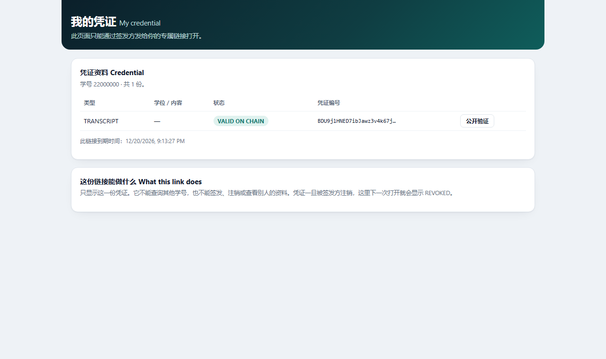

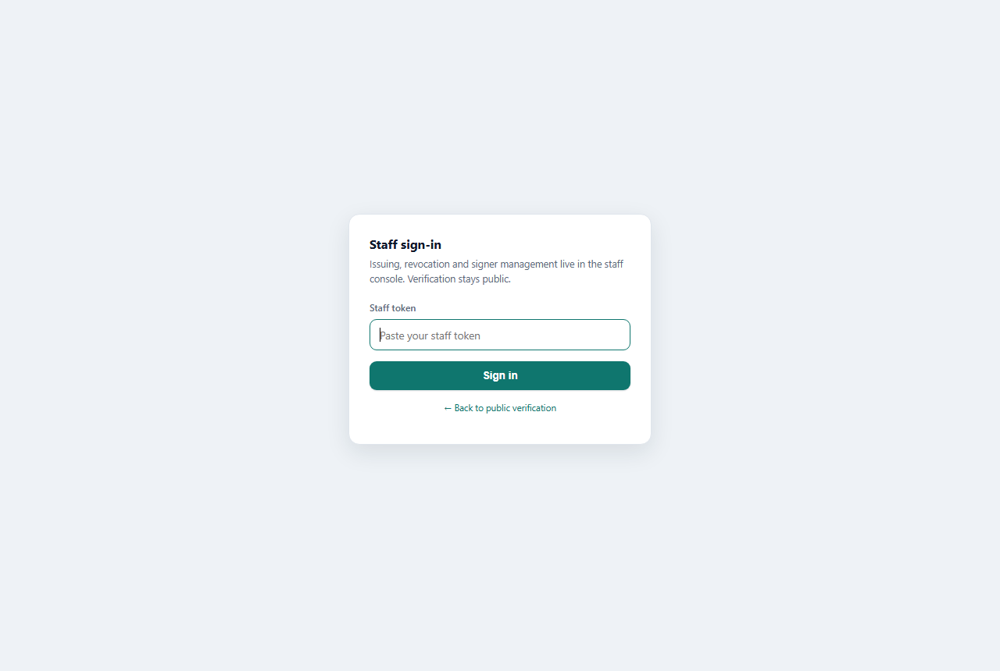

**Public landing page (`/`)**:

- **我要验证 (Verify)** — drag a PDF/JSON onto the drop zone, or paste a
  credential hash, or click a sample (真实有效 / 已注销 / 查无此证). The
  verdict card shows plain language (真实有效 VALID …), a holder summary,
  collapsible six-check details, and a downloadable receipt.
- **持证人 (Holder)** — paste the link the school gave you (`/me/<token>`)
  and open your own credential. The holder page shows the credential's
  issue point (block height and time), a verification QR, a **下载凭证 PDF**
  button (that link is the only anonymous-free path to the full file), and
  the revocation reason if it was revoked (U13 F3). There is **no** Student
  ID + DOB form any more: that was an enumerable privacy gate (see
  *Holder links*). A link whose 30-day life is down to its last week grows a
  **续期这个链接** button (U14): renewal re-signs the same credential in
  place, so a holder whose employer kept the link does not have to ask the
  office for a new one.

**Staff console (`/staff`)** — batch-issue wizard (CSV template, preview of
valid vs. problem rows, per-row full-PDF / QR / **holder link** buttons plus
a *导出全部持证人链接 CSV* export, U13 F5), single-issue card, revocation,
signer management and public API keys. The console is **role-aware** (U13
F4): it asks `/api/staff/whoami` on boot and hides `ADMIN` tabs the session
cannot use (an `ISSUER` session sees only the batch card, not single issue,
API keys, signer management or self-issue). The session chip counts down
(U13 F6) and returns to the login page when it expires. Two sign-out buttons
sit next to it (U14): **退出** closes this browser, **退出所有设备** drops
every live session of that role on the server, so a forgotten tab or a
shared laptop cannot hold the console open. Each role keeps at most three
live sessions (the fourth login evicts the oldest), and the login form brakes
after five wrong tokens from one address within ten minutes. The notification
recipient is **not** a field here: the server records the event and mails
only its configured `NOTIFY_TO`.
- **Ask the AI tab** — click a suggested question or type your own — answers
  come with source citations.
- **Log tab** — anonymized verification log, chain tail, IsolationForest
  anomaly watch + chart, and the notification feed.

> No ML stack installed? The portal still works: the embedder falls back to a
> deterministic hashing embedder and numpy search, and the generator falls back
> to a rules-based offline engine. Same UI, lower retrieval quality. PDF
> rendering needs `reportlab` + `pypdf`; anomaly isolation needs `scikit-learn`
> (falls back to the deterministic threshold rule).

Run the tests (isolated throwaway chains):

```bash
python -m unittest discover tests -v
# 94 tests across 10 modules (incl. batch issue, employer pack, public mode, restart persistence)
# round 9: 100 tests across 11 modules (added tests/test_pdf_extract.py — 6 cases)
```

## Endpoints

| Method | Path | Purpose |
|---|---|---|
| GET  | `/` | One-screen verify page (U25): paste a hash or pick a PDF, read one sentence. Assets: `simple.css` + `simple_verify.js` |
| GET  | `/issue` | Three-field issuing page (U25): name / student id / degree → hash, PDF, verify link. The action stays admin-guarded and the page only reveals the token box when no staff session is present |
| GET  | `/portal` | The previous multi-tab console (six checks, batch, log, chat) — no issuing code in the bundle |
| GET  | `/showtime` | Stage screen (U26): issue → verify → revoke → verify, four real API calls, scannable QR pointing at `PUBLIC_BASE_URL` |
| GET  | `/staff` | Staff console — 404 without a configured staff token; 303 to `/staff/login` without a session |
| GET  | `/staff/login` | Staff token form (posts the token once, gets an HttpOnly session cookie) |
| POST | `/staff/login` | Exchange `{"token"}` for a `staff_sid` cookie; 401 on a bad token |
| POST | `/staff/logout` | Drop the session server-side and clear the cookie |
| POST | `/staff/logout/all` | Drop every live session of the caller's role (U14) — `{ok, role, dropped}`; 401 without a session |
| GET  | `/me/{cap}` | Holder page for a signed link (404 for forged/expired/wrong-scope) |
| GET  | `/healthz` | Chain status: name, algo, height, registered signers, and `integrity` (`ok` + `bad_blocks` + `checked_at`/`age_s`). A false integrity flips the top-level status to `degraded` (U15); the age makes the 30 s cache visible (U23) |
| GET  | `/api/version` | Verifier identity + version + uptime (seconds) + chain snapshot (incl. `integrity`) + status-list digest (public in both modes) |
| GET  | `/api/diagnostics` | **Staff only** (U19): the *text* behind `/healthz`'s counts — config `fatal`/`warnings` messages, chain integrity, signers with `retired_at_height`, version, `uptime_s`. `/healthz` stays public and count-only |
| POST | `/api/issue` | Issue a credential (`{"document": {...}}`; `student_email` is accepted but **ignored** since U12 R4) — returns hash, height, `pdf_url`, notification status (`queued`/`duplicate`) |
| POST | `/api/issue/batch` | Registrar wizard: `{"credentials": [{"document"}, ...]}` (≤`BATCH_ISSUE_MAX`) — per-row ok/error + hash + `pdf_url` + `qr_url` + summary; bad rows never block good rows (admin/issuer) |
| POST | `/api/revoke` | Revoke by hash or by full document (creates a REVOKE block) |
| GET  | `/api/verify/{hash}` | Hash-level verdict: checks 1,2,3,5,6 (4 needs the document) |
| GET  | `/api/status/{hash}` | Raw lifecycle: issued/revoked + block heights |
| POST | `/api/verify/document` | Full six-check verdict — JSON body, multipart `.json` file, or multipart **portal-issued PDF** |
| POST | `/api/extract/pdf` | PDF auto-fill (round 9): upload a certificate PDF → `{mode, confidence, document, field_confidence, warnings}` — a JSON *draft* for the form, never a verdict |
| POST | `/api/verify/batch` | Employer pack: `{"hashes": [...]}` (≤500) → per-row verdicts + receipt IDs + summary |
| GET  | `/api/statuslist` | Signed revocation status list (ETag-cacheable, rebuilt on chain change); v2 signature carries nonce + signer fingerprint |
| GET  | `/api/signers/keys` | Public keys in PEM + fingerprints + retirement boundaries — the offline trust anchor (U17) |
| GET  | `/api/receipt/{id}` | Receipt registry lookup (`RCP-...`) — was this receipt issued by our verifier? |
| GET/POST/DELETE | `/api/admin/apikeys[/{id}]` | Public API-key lifecycle (create / list / revoke; admin) |
| GET  | `/api/pdf/{hash}` | **Verification report** PDF for a public hash: identity withheld, no embedded JSON (U13 F1). Anyone can fetch it; it proves what the chain says, not who holds it |
| GET  | `/api/admin/pdf/{hash}` | The **full credential** PDF (embedded JSON attachment) — staff only, U13 F1 |
| GET  | `/api/me/{cap}` | The one credential behind a holder link, with live status, `issued_at`, `issued_height`, and `revoked_reason` (404 for invalid/expired) |
| GET  | `/api/me/{cap}/pdf` | The holder's own full credential PDF — only through a signed link, U13 F1 |
| POST | `/api/me/{cap}/renew` | Re-sign the same credential with a fresh 30-day link (U14) — only in the last 7 days of the current one, otherwise 403 |
| GET  | `/api/staff/whoami` | `{role, demo_open, session_seconds_left, client_ip}` for the console's role-aware UI (U13 F4/F6); `client_ip` is the bucket key actually used (U24) |
| GET  | `/api/holder-link?student_id=&hashed_document=` | Mint a holder link (staff only) — `{token, path, expires_in}` |
| GET  | `/api/signers` | Registered signers + which one is active |
| POST | `/api/signers` | Register a new signer key (`{"name", "ds_algo"}`; admin) |
| POST | `/api/signers/active` | Switch the active signer (`{"sha256fgpt"}`; admin) |
| POST | `/api/signers/retire` | Retire a signer without deleting it: keeps its pre-retirement blocks valid, refuses new ones (`{"sha256fgpt"}`; 422 on the active signer; admin) |
| GET  | `/api/notifications` | Recent email notifications (dry-run records included) — **staff only** (U13 F2) |
| POST | `/api/chat` | RAG answer: `{"question", "session_id"?, "web"?}` → answer + sources + `person` (masked profile) + `web` (public lookups) |
| GET  | `/api/chat/suggestions` | Suggested questions for the UI chips |
| GET  | `/api/rag/status` | Which embedder/generator are active + index size |
| GET  | `/api/demo/credentials` | Sample credentials + hashes for the UI's try-it buttons |
| GET  | `/verify` | QR scan target: same UI, auto-verifies `?hash=...` |
| GET  | `/api/qr/{hash}` | PNG QR code encoding the public verification URL |
| GET  | `/api/log` | Anonymized recent verifications (persisted) + the chain tail |
| GET  | `/api/anomalies` | IsolationForest/rule flags + hourly issue histogram |

## The six checks

`verify_document` returns per-check booleans; all six must pass for **VALID**:

1. **Chain integrity** — whole chain re-verifies from genesis (hashes, links, heights)
2. **Signer trusted** — every ISSUE-block signer is in the registry (SPKI fingerprint)
3. **On-chain record** — an ISSUE block exists whose `HashedDocument` matches
4. **Hash match** — recomputed part-hashes of the presented document equal the on-chain payload
5. **Signature valid** — each signer's `DSignature` verifies over the nonce-HMAC message
6. **Not revoked** — no REVOKE block references this document hash

A hash lookup cannot run check 4 (it needs the full document), so it reports
`hash_match: null` and a verdict of `VALID ON CHAIN` / `REVOKED` / `NOT FOUND` /
`INVALID` / `CHAIN DATA CORRUPT`.

## How the AI chat works (Week 2)

```
question ──► exact lookup (hash / StudentID / name, pinned first)
          ──► embeddings: sentence-transformers/all-MiniLM-L6-v2 (CPU)
          ──► FAISS IndexFlatIP (cosine) over chain blocks + raw credentials
          ──► generator (priority):
               1. DeepSeek API   (DEEPSEEK_API_KEY set)
               2. Ollama         (OLLAMA_BASE_URL set, e.g. qwen2.5:3b)
               3. offline engine (always available, deterministic)
          ──► answer + cited sources
```

The corpus is built from one chain-info record, one record per block
(ISSUE/REVOKE with hashes + DocumentInfo), and one per raw credential JSON
(kept under `rawjsondocs/<hash>.json`). The index rebuilds lazily whenever the
chain changes. Exact identifiers are matched before vector search, so
"student 77778888" answers are exact, not approximate. The offline engine only
reads chain state, so it cannot hallucinate.

## Person in context + web research (extras round 3)

**Person in context.** When a question names a person (or an exact StudentID),
`/api/chat` resolves them into a masked profile card:

- name, masked StudentID (`2200****`), document type, degree, dates, honour,
  issuer, issue date, verdict + height, hash prefix;
- **privacy is hard**: DOB is never included, StudentID is truncated, and only
  the 12-char hash prefix is shown — the profile is safe to show a verifier;
- the same credential the profile points to is pinned into the RAG records, so
  the text answer always agrees with the card (same hash, same height);
- a per-session memory (`session_id` from the UI) anchors follow-ups: "Tell me
  about CHAN TAI MAN" then "what degree does he hold?" keeps the same person.

**Web research.** Asking "search the web / in the news / on the internet …" or
clicking *Search the web for \<name\>* runs `app/web_research.py`:

- real backends: Wikipedia search API, then DuckDuckGo Instant Answer — both
  free and keyless;
- **the query is only the person's name + issuing organisation** — StudentID
  and DOB are never sent to a public API;
- results come back as a labeled *Web research · public sources* card with
  links, explicitly noted as **public-web lookups, not chain records** — the
  verdict never depends on them;
- if the server has no outbound internet, the answer says so honestly
  (`status: "unavailable"`). `WEB_RESEARCH_MOCK=1` enables clearly-labeled
  demo-fixture results (DEMO DATA badge) so the UI can be demonstrated without
  a network; mock sources carry `sample: true` and are never presented as real.

## Week 3 hardening

**Rate limiting** — in-memory sliding window per client IP (respects
`X-Forwarded-For`). Public endpoints default to 120 req/min, admin endpoints
(`/api/issue`, `/api/revoke`, `/api/signers*`) to 30 req/min; over the limit
you get `429`. `app/rate_limit.py`.

**Input guards** — bodies over 6 MB rejected (`413`) before parsing; uploaded
credentials capped at 5 MB, parsed JSON at 2 MB, nesting depth at 50 — a "zip
bomb" document is rejected with `422`. Admin endpoints validate the same
document shape before issuing.

**Corrupted chain data** — missing/unreadable blocks or `info.yaml` no longer
500: verify endpoints return a structured `CHAIN DATA CORRUPT` verdict with the
reason, `status` returns `503` with a clear message, `info.yaml` writes are
atomic (temp file + rename), and `verify_block` reports "broken" instead of
crashing. The repo-root originals are untouched; the portal copy is the
hardened demo build.

**Deployment** — [`render.yaml`](render.yaml) (Render blueprint, free tier)
and [`railway.toml`](railway.toml) (Railway) both point at the Dockerfile,
which installs CPU-only torch first to keep the image ~2 GB. Steps:

1. Push this folder to a Git repo.
2. Render: **New → Blueprint → connect repo** (uses `render.yaml`), or
   Railway: **New Project → Deploy from repo** (reads `railway.toml`).
3. Set `ADMIN_TOKEN` for a public deployment.
4. Optional: `DEEPSEEK_API_KEY` / `OLLAMA_BASE_URL` for LLM chat;
   `EMAIL_ENABLED=1` + `SMTP_*` for real emails.
5. Set `PUBLIC_BASE_URL=https://your-app…` so QR codes and PDFs carry the
   public verification link.
6. The service exposes `/healthz` for the platform health check.

Every launch path in this repo already passes `--no-proxy-headers` (uvicorn
trusts `X-Forwarded-For` from 127.0.0.1 by default, which would let a forged
header pick its own rate-limit bucket). If you *do* put a proxy in front,
configure both layers with the same address — `--forwarded-allow-ips=<proxy>`
for uvicorn and `TRUSTED_PROXIES=<proxy>` for the app — otherwise one of them
will silently be the deciding vote. `GET /api/staff/whoami` echoes the bucket
key and `scripts/smoke_portal.py` probes a forged header, so the mismatch is
visible rather than silent.

The sandbox cannot hold a hosting account, so the URL step is left for you —
everything else is one click once the repo exists.

## Post-Week-3 extras (round 1)

- **QR codes** — `GET /api/qr/{hash}` returns a PNG QR encoding
  `{PUBLIC_BASE_URL}/verify?hash=...`; scanning opens the portal and
  auto-verifies. *QR for CV* on the Verify tab; after issuing, *Show QR* on the
  Issue tab. Requires `qrcode`.
- **Public log** — `GET /api/log` returns the last 50 verifications (hash
  truncated to 12 chars — anonymized) plus the last 10 chain blocks. The Log
  tab shows both tables.
- **Anomaly watch** — see round 2 (upgraded to IsolationForest).

## Post-Week-3 extras (round 2)

- **Verifiable diploma PDFs** — three forms since U13 F1, because a hash is a
  public identifier and not a credential:
  - `GET /api/pdf/{hash}` → **verification report**: identity fields read
    `withheld`, no JSON attachment, `Cache-Control: public`; `verification-*.pdf`.
  - `GET /api/admin/pdf/{hash}` → **full credential** (student name, degree,
    dates, on-chain hash, QR, embedded JSON), staff only; `credential-*.pdf`.
  - `GET /api/me/{cap}/pdf` → the same full file, but only through the holder's
    signed link.

  A PDF is a static artefact, so since U14 both full-file routes also paint a
  red **REVOKED ON CHAIN — block #N** band (with the issuer's reason, or "no
  reason was recorded") when the hash has a REVOKE record. The chain is still
  the authority; the band only stops a revoked file being mistaken for a live
  credential.

  U19 adds the same treatment for a **broken chain**: when `chain_integrity()`
  reports `ok: false`, every PDF (report, full credential, holder copy) prints
  `CHAIN INTEGRITY FAILED: block #N.` plus one line explaining that the verdict
  may be unreliable, and the footer moves down to make room. `integrity=None`
  means "not checked", never "clean".

  The QR on the page had never actually been drawn until U19 — the buffer was
  passed straight to `canvas.drawImage`, which rejects a `BytesIO` with a
  `TypeError` that a `except ... pass` swallowed. It now goes through
  `ImageReader`, and if a QR still cannot be produced the page prints
  `Verify online: <url>` instead, so a printed report always has an entry point.

  U21 puts every vertical position into `LAYOUT` and exposes `layout_zones` /
  `layout_conflicts`, so the gaps between the hash box, QR, revocation band,
  integrity lines and footer are asserted in tests rather than eyeballed. A
  field too long for the card stops the row loop at `body_floor`, prints
  `(fields too long for the card are complete in the embedded JSON)`, and leaves
  the QR room intact; the QR itself falls back 28mm → 20mm → printed URL.

  The verifier uploads a **full** credential PDF and the portal reads the
  embedded JSON to run the exact six checks — no OCR, no false verdicts.
  `POST /api/verify/document` accepts that PDF directly; a report PDF is
  rejected on purpose (there is no credential inside it). A student can print
  the full PDF, email it, or put it on a CV; anyone can verify it at the
  portal. (`app/pdf_diploma.py`, reportlab + pypdf.)
- **IsolationForest anomaly detection** — `GET /api/anomalies` now fits a real
  scikit-learn `IsolationForest` over each signer's hourly issue counts
  (contamination 0.15, per-signer) and merges the flags with the deterministic
  threshold rule; the response reports which `method` ran and each flag's
  `reasons` (`["isolation_forest"]`, `["rule"]`, or both). The Log tab shows
  the method badge, flags, and a 24-hour histogram. Falls back to rule-based
  when sklearn is missing, so it never breaks.
- **Persistent public log** — every verification is appended to
  `data/public-log.jsonl` and reloaded on startup, so the log survives
  restarts (bounded file, unwritable-FS fallback to memory-only).
- **Holder links** — the school mints a signed link per credential
  (`GET /api/holder-link`, staff only), and the holder opens `/me/<token>`.
  The token is `base64url(payload).HMAC-SHA256` and carries the StudentID, the
  credential hash and an expiry; a forged, edited, expired or out-of-scope
  token all answer the same 404. The link is scoped to **one** credential, so
  a leaked link cannot enumerate the rest. Status is re-read from the chain on
  every open, so a revocation shows up without reissuing the link.
  `GET /api/student/{id}?dob=` is **gone**: an eight-digit DOB with no token
  and no rate limit was an enumerable gate.
- **Multi-signer admin** — `GET/POST /api/signers` lists and registers trusted
  signers (generates fresh ML-DSA_65 / RSA-PSS_2048 / ec.secp256r1 keys,
  private keys held under `data/demo-chain/keys/`); `POST /api/signers/active`
  switches which signer signs new blocks. The Signers tab shows the registry,
  the active badge, and the Make-active control.
  `POST /api/signers/retire` retires a key **without deleting it**: the entry and
  public key stay in `info.yaml` and gain a `retired_at_height` boundary, so blocks
  it signed before that height still verify while anything after it does not. The
  active signer cannot be retired (422) — switch first, or its next block would be
  signed by an untrusted key and the whole chain would read INVALID, which is
  exactly how the U15 demo chain broke. Re-registering the same public key clears
  the boundary.
- **Email notifications, worker-ised (U12 R4)** — `/api/issue` only **queues**
  an event; a daemon thread started by the app lifespan delivers it. The
  recipient is the deployment's `NOTIFY_TO`, never a value from the request
  body (a `student_email` field is accepted and ignored). One notification per
  credential, at most `NOTIFY_PER_HOUR` attempts per hour, `logged` when
  `NOTIFY_TO` is unset. Real SMTP+TLS when `EMAIL_ENABLED=1` + `SMTP_*` are
  set, otherwise a recorded dry-run.

## Post-Week-3 extras (rounds 5–7)

**Public verifier mode (round 5).** `PUBLIC_MODE=1` turns the deployed app
into a verification-only service: every admin endpoint returns `403` ("Admin
functions are disabled in public verifier mode…"), the UI hides the
Issue/Revoke/Signers tabs and shows an amber banner, and `/api/demo/credentials`
adds a **REVOKED sample** — a credential that is issued *and* revoked on the
chain exactly once (idempotent across restarts). The landing page gets
one-click **VALID / REVOKED / Not on chain** sample buttons.

**Verdict receipt (round 5).** Every verification returns a `receipt_id`
(`RCP-…`), and the verdict card offers **Download / Print receipt**: a
standalone HTML page with the six checks, receipt ID, credential hash,
timestamp, verifier version, chain name + height, and the disclaimer — *VALID
means the six checks passed against the chain at this timestamp; it is not a
legal certification.* No DOB and no Student ID appear in the receipt.

**Employer pack (round 6).**
- **Batch verify** — `POST /api/verify/batch` (max 500 hashes) returns
  per-row verdicts + receipt IDs + a summary; `scripts/batch_verify.py` does
  CSV-in/CSV-out with passthrough columns and a machine-readable summary row.
- **Public API keys** — `POST /api/admin/apikeys` creates a key (raw key shown
  once, only its SHA-256 digest is stored); `Authorization: Bearer <key>`
  gets its own per-key rate bucket (`API_KEY_MAX`/min). Revoked keys are
  rejected with `401`.
- **Signed revocation status list** — `GET /api/statuslist` returns
  `{schema, snapshot, counts, revoked[], signature}` signed by the active
  signer, cached per chain snapshot, ETag-negotiated (`304`). Employers can
  cache it and answer "is this revoked?" offline — and, since U17, they can
  actually **check** the signature: `signature` carries the nonce, the signing
  key's `sha256fgpt` and its registry name, and `GET /api/signers/keys`
  publishes the matching public keys in PEM with retirement boundaries.
  `scripts/verify_statuslist.py` does the offline check (and `--hash` lookup)
  from two saved JSON files, with no call back to the portal. Schema is
  `gef26.statuslist.v2`; v1 lists cannot be verified (they had no nonce) and
  should be refetched. A signature only proves the list and the anchor agree —
  so `--expect <fingerprint>` (the fingerprint you already know out of band)
  pins *which* key must have signed, and `--pin <file>` records the anchor's
  fingerprint set on first use and refuses any later variation; a corrupt pin
  fails closed rather than quietly restarting trust. Since U20 a legitimate
  rotation is `--pin-update`: it rewrites the pin **only when the list
  verifies**, appends the old/new sets plus a UTC timestamp to the pin's
  `history`, and warns when no `--expect` was given (see
  `docs/U20_pin_rotation.md`).
- **Receipt registry** — `GET /api/receipt/{id}` confirms a receipt was
  issued by this verifier (ring-buffered to `RECEIPT_REGISTRY_CAP`).
- **Revocation reason / effective date** — `POST /api/revoke` accepts
  `reason` + `effective_at`; both are recorded on the REVOKE block and
  surfaced on verdicts, batch rows and the status list. `effective_at` is
  metadata (verdicts do not consult it), so it is **rejected when in the future**
  (422, tolerance 60 s) rather than being silently ignored while revoking at once.

**Persistence (round 7).** `scripts/backup_chain.py export|import` produces a
single `.tar.gz` of the chain (+ raw docs, optionally excluding private keys).
With `CHAIN_SNAPSHOT_URL` set and an empty chain dir at boot, the app restores
the snapshot before seeding — the free-tier restart story. See
[`docs/DEPLOY.md`](docs/DEPLOY.md).

## UX round (round 8)

The UI was rebuilt so a non-developer can get a result in under a minute:

- **Landing by role** — three entry cards (验证学历 / 我是学生 / 我是学校管理员)
  route to the right workflow; `/verify` and `/verify?hash=…` land directly on
  the Verify tab (QR scan target).
- **Drag-and-drop verify** — drop a portal-issued PDF or credential JSON onto
  the zone (or click to pick); the file is verified immediately, no buttons to
  find. Paste-a-hash is one field + one button.
- **Plain-language verdicts** — 真实有效 VALID / 已注销 REVOKED / 查无此证 NOT
  FOUND / 无效 INVALID / 链数据损坏; a holder summary card (name, degree,
  issuer…) appears when a document was uploaded; the six checks are collapsed
  behind a "查看 6 项安全检查" toggle for people who don't need the detail.
- **Friendly errors** — non-portal PDFs, oversized files, malformed hashes and
  rate limits get translated into human guidance instead of raw HTTP detail.
- **Registrar batch-issue wizard** — download the CSV template, paste/upload a
  roster, live preview (valid rows vs. problem rows with reasons), one click to
  issue everything via `POST /api/issue/batch`; results table per row with
  PDF/QR download links. Empty/duplicate/malformed rows are reported per-row
  and never roll back the good ones.
- **Student share links** — the student table now has a one-click 分享链接 that
  copies the public `/verify?hash=…` URL.
- **Bilingual** — Chinese-first labels with English secondary throughout
  (the HTML `<title>` keeps "Credential Verification Portal" so
  `test_features::test_verify_page_serves_ui` still passes).

Sample buttons: the VALID sample uses the seeded diploma, REVOKED is shown only
in public mode (it needs an on-chain revocation), NOT-FOUND is a fabricated
hash — the UI labels which are available.

## PDF auto-fill (round 9)

Upload a certificate PDF and the portal fills the credential JSON for you:

- **Embedded payload (portal-issued PDFs)** — the PDF carries
  `credential.json`; extraction is byte-exact, `mode=embedded_payload`,
  confidence 1.0. Green note: "已从凭证 PDF 内嵌数据精确提取".
- **Text layer (electronic certificates)** — label-aware regex extraction
  (English + Chinese labels: Surname/姓, Student ID/学号, Degree/学位,
  Issuing Organisation/签发机构…), `mode=text_extract`, per-field confidence,
  low-confidence fields surfaced, missing fields left empty (never invented).
- **Boundaries** — extraction is *input assistance only*: it never submits a
  verification, never bypasses the six checks, and an OCR-less scan-like PDF
  gets a friendly 422 ("没有可提取的文本层") instead of a made-up result.
- **Where it lives** — the Verify tab dropzone (upload PDF → JSON fills →
  click 验证凭证) and the Issue tab (上传 PDF 自动填充) both use
  `POST /api/extract/pdf`; the shared 5 MB / rate-limit guards apply.

## Quick API demo

```bash
# Issue a credential (returns hash + pdf_url + notification status)
# Note: student_email is accepted for backward compatibility but ignored —
# the notification goes to the deployment's NOTIFY_TO.
curl -X POST http://127.0.0.1:8000/api/issue -H 'Content-Type: application/json' \
  -d '{"document":{"PersonalParticulars":{"Surname":"LEE","GivenNames":"SIU MING","Sex":"M","DOB":"19901212","StudentID":"87654321"},"AcademicInfo":{"DegreeName":"Bachelor of Science in Computing","DegreeStartDate":"20190901","DegreeEndDate":"20230501","Honour":"2ND HON","Observations":""},"DocumentInfo":{"DateOfIssue":"20230520","AuthorizedSignature":"PRESIDENT Prof. QUO, Vadis","IssuingO":"UNIVERSITY OF UTOPIA","IssuingOU":"DEPT OF COMPUTING","DocType":"CERTIFICATE OF DIPLOMA"}}}'

# Mint a holder link for that credential (staff only), then open it
curl "http://127.0.0.1:8000/api/holder-link?student_id=87654321&hashed_document=<hash>" \
  -H "X-Admin-Token: $ADMIN_TOKEN"
curl "http://127.0.0.1:8000/api/me/<token>"

# Ask the AI — person in context + web research
curl -X POST http://127.0.0.1:8000/api/chat \
  -H 'Content-Type: application/json' \
  -d '{"question":"Tell me about CHAN TAI MAN","session_id":"demo"}'
curl -X POST http://127.0.0.1:8000/api/chat \
  -H 'Content-Type: application/json' \
  -d '{"question":"Search the web for CHAN TAI MAN","session_id":"demo"}'
```

## Configuration (env vars)

| Variable | Default | Meaning |
|---|---|---|
| `CHAIN_DIR` | `./data/demo-chain` | Where the chain lives (delete it to re-seed) |
| `CHAIN_NAME` | `Gef26-credential-chain` | Chain name in info.yaml |
| `SIGNER_ALGO` | `ML_DSA_65` | Initial signer algorithm (ML-DSA / RSA-* / ec.*) |
| `SIGNER_NAME` | `UNIVERSITY OF UTOPIA` | Initial signer display name |
| `GEF_KEY_PASSPHRASE` | *(unset)* | Encrypt signer private keys at rest (PKCS#8 PBES2). When set, newly written keys are encrypted and an existing plaintext key is re-encrypted on first load; a passphrase that does not match the key on disk stops issuing with a clear error instead of generating a new key |
| `ADMIN_TOKEN` | *(unset)* | Staff token. When set: `X-Admin-Token: <token>` for CLI, and the `/staff` login form for a browser. Required for `/staff` and `/staff/login` to exist at all |
| `ISSUER_TOKEN` | *(unset)* | Optional narrower token that can only bulk-issue (no revoke / signer / API-key rights) |
| `DEMO_OPEN` | `1` | U13 F7: what an instance with **no** role token does on admin routes. `1` = allow (the old demo behaviour, and `/api/version` + the public page say so); `0` = fail closed with 401 and a message naming the variable. Set `0` on anything reachable from a network |
| `CAPABILITY_SECRET` | *(derived from ADMIN_TOKEN)* | HMAC key for holder links. Unset *and* no `ADMIN_TOKEN` → a per-process random key, so links die on restart. Set it explicitly before demoing |
| `CAPABILITY_TTL` | `2592000` (30 days) | Holder link lifetime in seconds (clamped to 5 min … 1 year) |
| `CAPABILITY_RENEW_WINDOW` | `604800` (7 days) | U14: how close to expiry a holder may self-renew (`POST /api/me/{cap}/renew`) before the button appears |
| `NOTIFY_TO` | *(unset)* | The **only** notification recipient. Unset → events are recorded (`logged`) and nothing is sent |
| `NOTIFY_PER_HOUR` | `60` | Max notification attempts per hour; beyond it, `throttled` |
| `EMBED_MODEL` | `sentence-transformers/all-MiniLM-L6-v2` | Embedding model id |
| `DEEPSEEK_API_KEY` | *(unset)* | Enables DeepSeek generation (`deepseek-chat`) |
| `OLLAMA_BASE_URL` | *(unset)* | Enables Ollama generation (e.g. `http://127.0.0.1:11434`) |
| `OLLAMA_MODEL` | `qwen2.5:3b` | Ollama model to use |
| `RATE_LIMIT_ENABLED` | `1` | Set `0` to disable rate limiting |
| `RATE_LIMIT_PUBLIC_MAX` | `120` | Per-IP requests/minute on public endpoints |
| `RATE_LIMIT_ADMIN_MAX` | `30` | Per-IP requests/minute on admin endpoints |
| `PUBLIC_BASE_URL` | `http://127.0.0.1:8000` | Base URL embedded in QR codes + PDFs + emails |
| `ANOMALY_ISSUE_PER_HOUR` | `20` | Rule-fallback threshold: ISSUE blocks per signer per hour |
| `PUBLIC_MODE` | `0` | Set `1` for public verifier mode (no admin endpoints / UI) |
| `APP_VERSION` | `6.0.0` | Verifier version reported by `/api/version` + receipts |
| `API_KEY_MAX` | `600` | Per-key requests/minute for `Bearer` API keys |
| `RECEIPT_REGISTRY_CAP` | `5000` | Max stored receipt records (ring buffer) |
| `STATUSLIST_MAX_ENTRIES` | `20000` | Max revoked entries in the signed status list |
| `BATCH_ISSUE_MAX` | `200` | Max rows accepted by `POST /api/issue/batch` |
| `CHAIN_SNAPSHOT_URL` | *(unset)* | Boot-restore source: restore a `backup_chain.py` export when the chain dir is empty |
| `EMAIL_ENABLED` | `0` | Set `1` to send real email (else dry-run records) |
| `SMTP_HOST` | *(unset)* | SMTP server for real email |
| `SMTP_PORT` | `587` | SMTP port (STARTTLS) |
| `SMTP_USER` / `SMTP_PASSWORD` | *(unset)* | SMTP auth |
| `EMAIL_FROM` | `SMTP_USER` | From-address for notification emails |
| `WEB_RESEARCH_ENABLED` | `1` | Set `0` to disable web research entirely |
| `WEB_RESEARCH_MOCK` | `0` | Set `1` for clearly-labeled demo-fixture web results (no network needed) |
| `SOFT_OCR` | `1` | Soft-check OCR flag (reserved; the soft-check module is not in this local copy) |

## Notes & honest boundaries

- **PDFs are now supported — but only portal-issued ones.** A rendered/printed
  diploma PDF cannot be OCR'd into the exact JSON fields this chain hashes, so
  verification stays exact by embedding the credential JSON inside the PDF the
  portal issues. Foreign PDFs get a clear error telling the user to upload the
  JSON instead.
- **Holder lookup has two sources, split by sensitivity.** `rawjsondocs/`
  holds the issuer's full copies (names, DOB, e-mail) and is used by RAG,
  PDF rendering and disclosure. `holder_index/` holds one PII-free row per
  credential (StudentID, hash, type, degree) and is what the holder flow and
  the holder-link mint read. A public instance can therefore be deployed with
  `holder_index/` and **no** `rawjsondocs/`, and the submission bundle ships
  neither (it carries no `data/` at all, and the build fails if the finished
  zip contains a `rawjsondocs` path, a `.pem`, or a `"DOB"`/`"Email"` key).
- **The offline generator is the demo default** (no API key needed). Set
  `DEEPSEEK_API_KEY` or `OLLAMA_BASE_URL` for LLM answers; both fall back to
  the offline engine on failure.
- **Private keys live in `data/demo-chain/keys/` for the demo only**;
  production would use a KMS/HSM (parent-repo README says the same).
- **Emails are dry-run by default** — the sandbox has no mail server. Set
  `EMAIL_ENABLED=1` + `SMTP_*` to send; failures are recorded, never thrown.
- **Web research needs outbound internet.** This sandbox only allows an
  allowlist of hosts, so real lookups report `unavailable` here; any normal
  deployment (Render/Railway) gets live Wikipedia/DuckDuckGo results with zero
  config. `WEB_RESEARCH_MOCK=1` is a demo-only switch that returns
  clearly-labeled sample results (DEMO DATA badge, `sample: true`) — never
  mistaken for real sources, and off by default.
- **This local copy tracks the latest build (rounds 5–7)** except the round-4
  OCR *soft-check* module (`app/pdf_softcheck.py`), which was not part of the
  packaged zip. Everything else — public mode, receipts, employer pack,
  persistence — is present. Add `pdf_softcheck.py` + the `/api/verify/soft`
  endpoint from the cloud build if you want that path.
- **Person profiles are masked by construction.** StudentID is truncated, DOB
  is never exposed, and web queries contain only name + organisation — no
  StudentID, no DOB.
- `app/blockchain_util.py` / `app/crypto_util.py` are the repo's core modules,
  copied with a 3-line import shim and the Week-3 robustness tweaks. The
  repo-root versions remain the source of truth.

## Layout

```
verification-portal/
├── app/                    # 37 modules (U0–U10 refactor; see docs/U1..U10 reports)
│   ├── main.py             # FastAPI app + endpoints + hardening middleware
│   ├── config.py           # env-driven config (all constants live here)
│   ├── errors.py           # domain exception hierarchy
│   ├── chain_core.py       # chain lock, paths, signer keys, seeding, snapshot restore
│   ├── blockchain_util.py  # core chain: blocks, verification, read caches
│   ├── crypto_util.py      # core crypto: ML-DSA / RSA-PSS / ECDSA, JCS hash
│   ├── chain_service.py    # issue/revoke/verify + signers + student registry
│   ├── issuance_service.py # issuance + batch issuance (request-model driven)
│   ├── signer_service.py   # multi-signer management + signed chain snapshot
│   ├── query_service.py    # verify/status/statuslist read paths
│   ├── disclosure.py       # chapter-level selective disclosure
│   ├── privacy.py          # person-record masking rules
│   ├── repository.py       # five stores × JSON|SQLite + migration
│   ├── audit.py            # audit trail + operator identity (ContextVar)
│   ├── apikeys.py          # API keys: create / rotate / revoke / quota
│   ├── authz.py            # role model (admin / issuer)
│   ├── rate_limit.py       # sliding-window limiter
│   ├── session_store.py    # chat session memory seam (TODO[external-redis])
│   ├── chat_service.py     # RAG orchestration: retrieve -> generate -> sources
│   ├── person_context.py   # masked person profiles + session anaphora
│   ├── web_research.py     # Wikipedia/DuckDuckGo lookups + demo fixture
│   ├── rag_indexer.py      # corpus + FAISS index (numpy fallback)
│   ├── rag_embedder.py     # MiniLM-L6-v2 embeddings (hashing fallback)
│   ├── rag_generator.py    # DeepSeek / Ollama / offline engine
│   ├── pdf_diploma.py      # verifiable diploma PDFs
│   ├── pdf_extractor.py    # PDF auto-fill: embedded payload + text layer
│   ├── notifier.py         # email notifications, dry-run default
│   ├── public_log.py       # persistent anonymized log
│   ├── anomaly.py          # IsolationForest + rule signer-velocity watch
│   ├── observability.py    # structured request log + request ids
│   ├── startup.py          # boot-time config validation (counts in /healthz, text in /api/diagnostics)
│   ├── backup.py           # chain backup / restore drill primitives
│   ├── statuslist.py       # signed revocation status list
│   ├── receipt_registry.py # verification receipt registry (append-only JSONL)
│   ├── custom_service.py   # self-service credential maker
│   └── schemas.py          # pydantic request models
├── static/                 # index.html + app.js + styles.css (U6 split from 1799 → 392 lines)
├── tests/                  # 39 modules; scripts/run_all_tests.py runs them per-module
├── scripts/                # run_all_tests.py, smoke_portal.py (read-only check of a
│                           # running instance), local_smoke.py (in-process, temp chain),
│                           # batch_verify.py, backup_chain.py, restore_drill.py,
│                           # license_audit.py, verify_statuslist.py (offline list check)
├── docs/                   # U0–U10 acceptance reports, DEPLOY.md, SBOM, demo script
├── Dockerfile              # three-layer build (base / app / app+ML), non-root, healthcheck
├── start_portal.bat/.sh    # one-click launchers
├── demo.mp4                # ~2-minute walkthrough
├── Dockerfile             # CPU-torch first, ~2 GB image
├── render.yaml            # Render blueprint (free tier, public verifier)
├── railway.toml           # Railway config (public verifier)
└── requirements.txt
```
