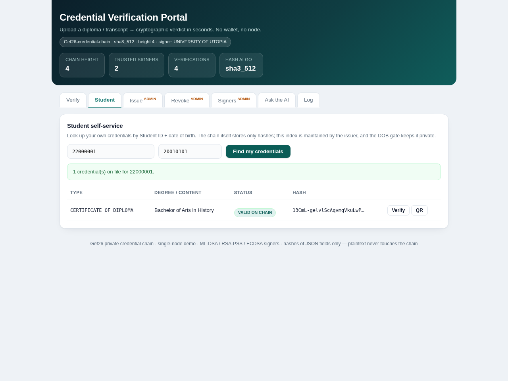

# Credential Verification Portal — Weeks 1–3 + extras rounds 1–8

A browser-accessible verification portal for the Gef26 private credential
chain. A verifier uploads (or pastes) a credential — JSON **or a portal-issued
diploma PDF** — and the portal runs the chain's six checks and shows a verdict.
No Python, no notebook, no blockchain knowledge required.

What's in the box, per the 3-week plan:

- **Week 1** — the portal: plain HTML + fetch UI, issue / revoke / verify /
  status endpoints, six-check verdicts (VALID / REVOKED / INVALID / NOT FOUND).
- **Week 2** — RAG chat: MiniLM-L6-v2 + FAISS retrieval, DeepSeek / Ollama /
  offline generator, answers with cited sources.
- **Week 3** — hardening (rate limiting, input guards, corrupted-chain
  handling), deployment configs (Render / Railway), README, demo video.
- **Extras round 1** — QR codes, public (anonymized) log, anomaly watch.
- **Extras round 2** — verifiable diploma PDFs, real IsolationForest anomaly
  detection, persistent log, student self-service lookup, multi-signer admin,
  email notifications, and a full visual/mobile polish pass.
- **Extras round 3** — *person in context*: the AI resolves who you're asking
  about into a masked profile card, keeps that person across follow-ups
  ("what degree does he hold?"), and can search the web for public info about
  that person (Wikipedia / DuckDuckGo), clearly labeled as web results and
  never mixed with chain facts.
- **Extras round 5** — **public verifier mode** (`PUBLIC_MODE=1`): the deployed
  URL verifies but cannot issue/revoke (admin endpoints 403, admin tabs
  hidden), `/api/version`, one-click VALID / REVOKED / NOT-FOUND samples, and a
  downloadable **verdict receipt** (receipt ID, six checks, verifier version,
  chain snapshot, disclaimer — no DOB).
- **Extras round 6 (employer pack)** — **batch verify** (API + CLI + CSV
  results), **public API keys** with per-key rate limits, a **signed
  revocation status list** (OCSP-like, ETag-cacheable), a **receipt registry**
  (`/api/receipt/{id}`), and revocation **reason / effective date** recorded
  on-chain and surfaced on verdicts.
- **Extras round 7 (persistence)** — `scripts/backup_chain.py` export/import
  and `CHAIN_SNAPSHOT_URL` boot-restore so a free-tier restart does not lose
  issued credentials.
- **Extras round 8 (UX)** — the UI is now built for non-developers: a role-based
  landing page (验证 / 学生 / 管理员), drag-and-drop PDF/JSON verification,
  plain-language verdicts (真实有效 / 已注销 / 查无此证 / 无效), collapsible
  six checks, a registrar **batch-issue wizard** (CSV → preview → one-click
  issue → per-row PDF/QR), student share links, friendlier errors, bilingual
  labels, and one-click launchers (`start_portal.bat` / `start_portal.sh`).
- **Extras round 9 (PDF auto-fill)** — upload a certificate PDF and the portal
  auto-fills the credential JSON form: portal-issued PDFs are extracted
  byte-exact from the embedded payload (`mode=embedded_payload`, confidence
  1.0); text-layer electronic certificates get label-aware field extraction
  with per-field confidence + warnings (`mode=text_extract`). Extraction is
  input assistance only — it never bypasses the six cryptographic checks, and
  the user always reviews and clicks Verify. Endpoint: `POST /api/extract/pdf`.





**Demo video:** [`demo.mp4`](demo.mp4) — ~2-minute walkthrough: upload → VALID,
tamper → INVALID, Ask the AI → cited answer, revoke → REVOKED, QR, verifiable
PDF, public log, student lookup, signer admin, ship it. Rebuild with
`python3 scripts/build_demo_video.py`.

---

## Quick start

**One click (Windows):** double-click `start_portal.bat` — it creates the
virtualenv, installs dependencies on first run, starts the server and opens
the portal in your browser. macOS/Linux: `./start_portal.sh`. Both default to
private mode (issuing enabled); flip `PUBLIC_MODE=1` in the launcher for a
verification-only public instance.

```bash
cd verification-portal

# optional but recommended: ML stack in a project venv (CPU torch)
python3 -m venv --system-site-packages .venv
.venv/bin/pip install torch --index-url https://download.pytorch.org/whl/cpu
.venv/bin/pip install -r requirements.txt

# run (use `.venv/bin/python -m` if you made the venv)
uvicorn app.main:app --host 127.0.0.1 --port 8000
```

Open **http://127.0.0.1:8000** — the chain is created and seeded on first
startup (a trusted ML-DSA_65 signer + two sample credentials: a diploma and a
transcript). The landing page routes you by role:

- **我要验证 (Verify)** — drag a PDF/JSON onto the drop zone, or paste a
  credential hash, or click a sample (真实有效 / 已注销 / 查无此证). The
  verdict card shows plain language (真实有效 VALID …), a holder summary when a
  document was uploaded, and collapsible six-check details; one click downloads
  the verification receipt.
- **我是学生 (Student)** — Student ID + DOB → your credentials, with Verify /
  QR / share-link shortcuts.
- **我是学校管理员 (Registrar)** — batch-issue wizard: download the CSV
  template, paste/upload a roster, preview (valid rows vs. problem rows),
  one-click issue → per-row PDF / QR download; single-issue card and public
  API-key management are on the same tab.
- **Ask the AI tab** — click a suggested question or type your own — answers
  come with source citations.
- **Log tab** — anonymized verification log, chain tail, IsolationForest
  anomaly watch + chart, and the notification feed.

> No ML stack installed? The portal still works: the embedder falls back to a
> deterministic hashing embedder and numpy search, and the generator falls back
> to a rules-based offline engine. Same UI, lower retrieval quality. PDF
> rendering needs `reportlab` + `pypdf`; anomaly isolation needs `scikit-learn`
> (falls back to the deterministic threshold rule).

Run the tests (isolated throwaway chains):

```bash
python -m unittest discover tests -v
# 94 tests across 10 modules (incl. batch issue, employer pack, public mode, restart persistence)
# round 9: 100 tests across 11 modules (added tests/test_pdf_extract.py — 6 cases)
```

## Endpoints

| Method | Path | Purpose |
|---|---|---|
| GET  | `/` | Portal UI (plain HTML + fetch) |
| GET  | `/healthz` | Chain status: name, algo, height, registered signers |
| GET  | `/api/version` | Verifier identity + version + chain snapshot + status-list digest (public in both modes) |
| POST | `/api/issue` | Issue a credential (`{"document": {...}, "student_email": "..."}` optional) — returns hash, height, `pdf_url`, notification |
| POST | `/api/issue/batch` | Registrar wizard: `{"credentials": [{"document", "student_email"?}, ...]}` (≤`BATCH_ISSUE_MAX`) — per-row ok/error + hash + `pdf_url` + `qr_url` + summary; bad rows never block good rows (admin) |
| POST | `/api/revoke` | Revoke by hash or by full document (creates a REVOKE block) |
| GET  | `/api/verify/{hash}` | Hash-level verdict: checks 1,2,3,5,6 (4 needs the document) |
| GET  | `/api/status/{hash}` | Raw lifecycle: issued/revoked + block heights |
| POST | `/api/verify/document` | Full six-check verdict — JSON body, multipart `.json` file, or multipart **portal-issued PDF** |
| POST | `/api/extract/pdf` | PDF auto-fill (round 9): upload a certificate PDF → `{mode, confidence, document, field_confidence, warnings}` — a JSON *draft* for the form, never a verdict |
| POST | `/api/verify/batch` | Employer pack: `{"hashes": [...]}` (≤500) → per-row verdicts + receipt IDs + summary |
| GET  | `/api/statuslist` | Signed revocation status list (ETag-cacheable, rebuilt on chain change) |
| GET  | `/api/receipt/{id}` | Receipt registry lookup (`RCP-...`) — was this receipt issued by our verifier? |
| GET/POST/DELETE | `/api/admin/apikeys[/{id}]` | Public API-key lifecycle (create / list / revoke; admin) |
| GET  | `/api/pdf/{hash}` | Download the verifiable diploma PDF (embeds the exact JSON) |
| GET  | `/api/student/{id}?dob=YYYYMMDD` | Student self-service lookup (DOB gate required) |
| GET  | `/api/signers` | Registered signers + which one is active |
| POST | `/api/signers` | Register a new signer key (`{"name", "ds_algo"}`; admin) |
| POST | `/api/signers/active` | Switch the active signer (`{"sha256fgpt"}`; admin) |
| GET  | `/api/notifications` | Recent email notifications (dry-run records included) |
| POST | `/api/chat` | RAG answer: `{"question", "session_id"?, "web"?}` → answer + sources + `person` (masked profile) + `web` (public lookups) |
| GET  | `/api/chat/suggestions` | Suggested questions for the UI chips |
| GET  | `/api/rag/status` | Which embedder/generator are active + index size |
| GET  | `/api/demo/credentials` | Sample credentials + hashes for the UI's try-it buttons |
| GET  | `/verify` | QR scan target: same UI, auto-verifies `?hash=...` |
| GET  | `/api/qr/{hash}` | PNG QR code encoding the public verification URL |
| GET  | `/api/log` | Anonymized recent verifications (persisted) + the chain tail |
| GET  | `/api/anomalies` | IsolationForest/rule flags + hourly issue histogram |

## The six checks

`verify_document` returns per-check booleans; all six must pass for **VALID**:

1. **Chain integrity** — whole chain re-verifies from genesis (hashes, links, heights)
2. **Signer trusted** — every ISSUE-block signer is in the registry (SPKI fingerprint)
3. **On-chain record** — an ISSUE block exists whose `HashedDocument` matches
4. **Hash match** — recomputed part-hashes of the presented document equal the on-chain payload
5. **Signature valid** — each signer's `DSignature` verifies over the nonce-HMAC message
6. **Not revoked** — no REVOKE block references this document hash

A hash lookup cannot run check 4 (it needs the full document), so it reports
`hash_match: null` and a verdict of `VALID ON CHAIN` / `REVOKED` / `NOT FOUND` /
`INVALID` / `CHAIN DATA CORRUPT`.

## How the AI chat works (Week 2)

```
question ──► exact lookup (hash / StudentID / name, pinned first)
          ──► embeddings: sentence-transformers/all-MiniLM-L6-v2 (CPU)
          ──► FAISS IndexFlatIP (cosine) over chain blocks + raw credentials
          ──► generator (priority):
               1. DeepSeek API   (DEEPSEEK_API_KEY set)
               2. Ollama         (OLLAMA_BASE_URL set, e.g. qwen2.5:3b)
               3. offline engine (always available, deterministic)
          ──► answer + cited sources
```

The corpus is built from one chain-info record, one record per block
(ISSUE/REVOKE with hashes + DocumentInfo), and one per raw credential JSON
(kept under `rawjsondocs/<hash>.json`). The index rebuilds lazily whenever the
chain changes. Exact identifiers are matched before vector search, so
"student 77778888" answers are exact, not approximate. The offline engine only
reads chain state, so it cannot hallucinate.

## Person in context + web research (extras round 3)

**Person in context.** When a question names a person (or an exact StudentID),
`/api/chat` resolves them into a masked profile card:

- name, masked StudentID (`2200****`), document type, degree, dates, honour,
  issuer, issue date, verdict + height, hash prefix;
- **privacy is hard**: DOB is never included, StudentID is truncated, and only
  the 12-char hash prefix is shown — the profile is safe to show a verifier;
- the same credential the profile points to is pinned into the RAG records, so
  the text answer always agrees with the card (same hash, same height);
- a per-session memory (`session_id` from the UI) anchors follow-ups: "Tell me
  about CHAN TAI MAN" then "what degree does he hold?" keeps the same person.

**Web research.** Asking "search the web / in the news / on the internet …" or
clicking *Search the web for \<name\>* runs `app/web_research.py`:

- real backends: Wikipedia search API, then DuckDuckGo Instant Answer — both
  free and keyless;
- **the query is only the person's name + issuing organisation** — StudentID
  and DOB are never sent to a public API;
- results come back as a labeled *Web research · public sources* card with
  links, explicitly noted as **public-web lookups, not chain records** — the
  verdict never depends on them;
- if the server has no outbound internet, the answer says so honestly
  (`status: "unavailable"`). `WEB_RESEARCH_MOCK=1` enables clearly-labeled
  demo-fixture results (DEMO DATA badge) so the UI can be demonstrated without
  a network; mock sources carry `sample: true` and are never presented as real.

## Week 3 hardening

**Rate limiting** — in-memory sliding window per client IP (respects
`X-Forwarded-For`). Public endpoints default to 120 req/min, admin endpoints
(`/api/issue`, `/api/revoke`, `/api/signers*`) to 30 req/min; over the limit
you get `429`. `app/rate_limit.py`.

**Input guards** — bodies over 6 MB rejected (`413`) before parsing; uploaded
credentials capped at 5 MB, parsed JSON at 2 MB, nesting depth at 50 — a "zip
bomb" document is rejected with `422`. Admin endpoints validate the same
document shape before issuing.

**Corrupted chain data** — missing/unreadable blocks or `info.yaml` no longer
500: verify endpoints return a structured `CHAIN DATA CORRUPT` verdict with the
reason, `status` returns `503` with a clear message, `info.yaml` writes are
atomic (temp file + rename), and `verify_block` reports "broken" instead of
crashing. The repo-root originals are untouched; the portal copy is the
hardened demo build.

**Deployment** — [`render.yaml`](render.yaml) (Render blueprint, free tier)
and [`railway.toml`](railway.toml) (Railway) both point at the Dockerfile,
which installs CPU-only torch first to keep the image ~2 GB. Steps:

1. Push this folder to a Git repo.
2. Render: **New → Blueprint → connect repo** (uses `render.yaml`), or
   Railway: **New Project → Deploy from repo** (reads `railway.toml`).
3. Set `ADMIN_TOKEN` for a public deployment.
4. Optional: `DEEPSEEK_API_KEY` / `OLLAMA_BASE_URL` for LLM chat;
   `EMAIL_ENABLED=1` + `SMTP_*` for real emails.
5. Set `PUBLIC_BASE_URL=https://your-app…` so QR codes and PDFs carry the
   public verification link.
6. The service exposes `/healthz` for the platform health check.

The sandbox cannot hold a hosting account, so the URL step is left for you —
everything else is one click once the repo exists.

## Post-Week-3 extras (round 1)

- **QR codes** — `GET /api/qr/{hash}` returns a PNG QR encoding
  `{PUBLIC_BASE_URL}/verify?hash=...`; scanning opens the portal and
  auto-verifies. *QR for CV* on the Verify tab; after issuing, *Show QR* on the
  Issue tab. Requires `qrcode`.
- **Public log** — `GET /api/log` returns the last 50 verifications (hash
  truncated to 12 chars — anonymized) plus the last 10 chain blocks. The Log
  tab shows both tables.
- **Anomaly watch** — see round 2 (upgraded to IsolationForest).

## Post-Week-3 extras (round 2)

- **Verifiable diploma PDFs** — `GET /api/pdf/{hash}` renders a printable
  diploma card (student name, degree, dates, on-chain hash, QR) and **embeds
  the exact credential JSON as a PDF attachment**. The verifier uploads that
  PDF and the portal reads the embedded JSON and runs the exact six checks —
  no OCR, no false verdicts. `POST /api/verify/document` accepts the PDF
  directly. The PDF is a carryable artifact: a student can print it, email it,
  or put it on a CV; anyone can verify it at the portal. (`app/pdf_diploma.py`,
  reportlab + pypdf.)
- **IsolationForest anomaly detection** — `GET /api/anomalies` now fits a real
  scikit-learn `IsolationForest` over each signer's hourly issue counts
  (contamination 0.15, per-signer) and merges the flags with the deterministic
  threshold rule; the response reports which `method` ran and each flag's
  `reasons` (`["isolation_forest"]`, `["rule"]`, or both). The Log tab shows
  the method badge, flags, and a 24-hour histogram. Falls back to rule-based
  when sklearn is missing, so it never breaks.
- **Persistent public log** — every verification is appended to
  `data/public-log.jsonl` and reloaded on startup, so the log survives
  restarts (bounded file, unwritable-FS fallback to memory-only).
- **Student self-service** — `GET /api/student/{id}?dob=YYYYMMDD` lists the
  student's own credentials (type, degree, verdict, hash) from the issuer's
  `rawjsondocs/` index. The chain itself stores only hashes — plaintext never
  touches the ledger — and the DOB gate prevents revealing whether a StudentID
  exists at all. The Student tab renders the table with Verify/QR shortcuts.
- **Multi-signer admin** — `GET/POST /api/signers` lists and registers trusted
  signers (generates fresh ML-DSA_65 / RSA-PSS_2048 / ec.secp256r1 keys,
  private keys held under `data/demo-chain/keys/`); `POST /api/signers/active`
  switches which signer signs new blocks. The Signers tab shows the registry,
  the active badge, and the Make-active control.
- **Email notifications** — optional `student_email` on `/api/issue` triggers
  the notifier: real SMTP+TLS when `EMAIL_ENABLED=1` + `SMTP_*` are set,
  otherwise a recorded **dry-run** (shown on the Issue tab and the Log tab's
  notification feed). The message includes the verification link.

## Post-Week-3 extras (rounds 5–7)

**Public verifier mode (round 5).** `PUBLIC_MODE=1` turns the deployed app
into a verification-only service: every admin endpoint returns `403` ("Admin
functions are disabled in public verifier mode…"), the UI hides the
Issue/Revoke/Signers tabs and shows an amber banner, and `/api/demo/credentials`
adds a **REVOKED sample** — a credential that is issued *and* revoked on the
chain exactly once (idempotent across restarts). The landing page gets
one-click **VALID / REVOKED / Not on chain** sample buttons.

**Verdict receipt (round 5).** Every verification returns a `receipt_id`
(`RCP-…`), and the verdict card offers **Download / Print receipt**: a
standalone HTML page with the six checks, receipt ID, credential hash,
timestamp, verifier version, chain name + height, and the disclaimer — *VALID
means the six checks passed against the chain at this timestamp; it is not a
legal certification.* No DOB and no Student ID appear in the receipt.

**Employer pack (round 6).**
- **Batch verify** — `POST /api/verify/batch` (max 500 hashes) returns
  per-row verdicts + receipt IDs + a summary; `scripts/batch_verify.py` does
  CSV-in/CSV-out with passthrough columns and a machine-readable summary row.
- **Public API keys** — `POST /api/admin/apikeys` creates a key (raw key shown
  once, only its SHA-256 digest is stored); `Authorization: Bearer <key>`
  gets its own per-key rate bucket (`API_KEY_MAX`/min). Revoked keys are
  rejected with `401`.
- **Signed revocation status list** — `GET /api/statuslist` returns
  `{schema, snapshot, counts, revoked[], signature}` signed by the active
  signer, cached per chain snapshot, ETag-negotiated (`304`). Employers can
  cache it and answer "is this revoked?" offline.
- **Receipt registry** — `GET /api/receipt/{id}` confirms a receipt was
  issued by this verifier (ring-buffered to `RECEIPT_REGISTRY_CAP`).
- **Revocation reason / effective date** — `POST /api/revoke` accepts
  `reason` + `effective_at`; both are recorded on the REVOKE block and
  surfaced on verdicts, batch rows and the status list.

**Persistence (round 7).** `scripts/backup_chain.py export|import` produces a
single `.tar.gz` of the chain (+ raw docs, optionally excluding private keys).
With `CHAIN_SNAPSHOT_URL` set and an empty chain dir at boot, the app restores
the snapshot before seeding — the free-tier restart story. See
[`docs/DEPLOY.md`](docs/DEPLOY.md).

## UX round (round 8)

The UI was rebuilt so a non-developer can get a result in under a minute:

- **Landing by role** — three entry cards (验证学历 / 我是学生 / 我是学校管理员)
  route to the right workflow; `/verify` and `/verify?hash=…` land directly on
  the Verify tab (QR scan target).
- **Drag-and-drop verify** — drop a portal-issued PDF or credential JSON onto
  the zone (or click to pick); the file is verified immediately, no buttons to
  find. Paste-a-hash is one field + one button.
- **Plain-language verdicts** — 真实有效 VALID / 已注销 REVOKED / 查无此证 NOT
  FOUND / 无效 INVALID / 链数据损坏; a holder summary card (name, degree,
  issuer…) appears when a document was uploaded; the six checks are collapsed
  behind a "查看 6 项安全检查" toggle for people who don't need the detail.
- **Friendly errors** — non-portal PDFs, oversized files, malformed hashes and
  rate limits get translated into human guidance instead of raw HTTP detail.
- **Registrar batch-issue wizard** — download the CSV template, paste/upload a
  roster, live preview (valid rows vs. problem rows with reasons), one click to
  issue everything via `POST /api/issue/batch`; results table per row with
  PDF/QR download links. Empty/duplicate/malformed rows are reported per-row
  and never roll back the good ones.
- **Student share links** — the student table now has a one-click 分享链接 that
  copies the public `/verify?hash=…` URL.
- **Bilingual** — Chinese-first labels with English secondary throughout
  (the HTML `<title>` keeps "Credential Verification Portal" so
  `test_features::test_verify_page_serves_ui` still passes).

Sample buttons: the VALID sample uses the seeded diploma, REVOKED is shown only
in public mode (it needs an on-chain revocation), NOT-FOUND is a fabricated
hash — the UI labels which are available.

## PDF auto-fill (round 9)

Upload a certificate PDF and the portal fills the credential JSON for you:

- **Embedded payload (portal-issued PDFs)** — the PDF carries
  `credential.json`; extraction is byte-exact, `mode=embedded_payload`,
  confidence 1.0. Green note: "已从凭证 PDF 内嵌数据精确提取".
- **Text layer (electronic certificates)** — label-aware regex extraction
  (English + Chinese labels: Surname/姓, Student ID/学号, Degree/学位,
  Issuing Organisation/签发机构…), `mode=text_extract`, per-field confidence,
  low-confidence fields surfaced, missing fields left empty (never invented).
- **Boundaries** — extraction is *input assistance only*: it never submits a
  verification, never bypasses the six checks, and an OCR-less scan-like PDF
  gets a friendly 422 ("没有可提取的文本层") instead of a made-up result.
- **Where it lives** — the Verify tab dropzone (upload PDF → JSON fills →
  click 验证凭证) and the Issue tab (上传 PDF 自动填充) both use
  `POST /api/extract/pdf`; the shared 5 MB / rate-limit guards apply.

## Quick API demo

```bash
# Issue a credential (returns hash + pdf_url + notification)
curl -X POST http://127.0.0.1:8000/api/issue -H 'Content-Type: application/json' \
  -d '{"document":{"PersonalParticulars":{"Surname":"LEE","GivenNames":"SIU MING","Sex":"M","DOB":"19901212","StudentID":"87654321"},"AcademicInfo":{"DegreeName":"Bachelor of Science in Computing","DegreeStartDate":"20190901","DegreeEndDate":"20230501","Honour":"2ND HON","Observations":""},"DocumentInfo":{"DateOfIssue":"20230520","AuthorizedSignature":"PRESIDENT Prof. QUO, Vadis","IssuingO":"UNIVERSITY OF UTOPIA","IssuingOU":"DEPT OF COMPUTING","DocType":"CERTIFICATE OF DIPLOMA"}},"student_email":"lee@example.com"}'

# Student self-service
curl "http://127.0.0.1:8000/api/student/87654321?dob=19901212"

# Ask the AI — person in context + web research
curl -X POST http://127.0.0.1:8000/api/chat \
  -H 'Content-Type: application/json' \
  -d '{"question":"Tell me about CHAN TAI MAN","session_id":"demo"}'
curl -X POST http://127.0.0.1:8000/api/chat \
  -H 'Content-Type: application/json' \
  -d '{"question":"Search the web for CHAN TAI MAN","session_id":"demo"}'
```

## Configuration (env vars)

| Variable | Default | Meaning |
|---|---|---|
| `CHAIN_DIR` | `./data/demo-chain` | Where the chain lives (delete it to re-seed) |
| `CHAIN_NAME` | `Gef26-credential-chain` | Chain name in info.yaml |
| `SIGNER_ALGO` | `ML_DSA_65` | Initial signer algorithm (ML-DSA / RSA-* / ec.*) |
| `SIGNER_NAME` | `UNIVERSITY OF UTOPIA` | Initial signer display name |
| `ADMIN_TOKEN` | *(unset)* | If set, admin endpoints require header `X-Admin-Token: <token>` |
| `EMBED_MODEL` | `sentence-transformers/all-MiniLM-L6-v2` | Embedding model id |
| `DEEPSEEK_API_KEY` | *(unset)* | Enables DeepSeek generation (`deepseek-chat`) |
| `OLLAMA_BASE_URL` | *(unset)* | Enables Ollama generation (e.g. `http://127.0.0.1:11434`) |
| `OLLAMA_MODEL` | `qwen2.5:3b` | Ollama model to use |
| `RATE_LIMIT_ENABLED` | `1` | Set `0` to disable rate limiting |
| `RATE_LIMIT_PUBLIC_MAX` | `120` | Per-IP requests/minute on public endpoints |
| `RATE_LIMIT_ADMIN_MAX` | `30` | Per-IP requests/minute on admin endpoints |
| `PUBLIC_BASE_URL` | `http://127.0.0.1:8000` | Base URL embedded in QR codes + PDFs + emails |
| `ANOMALY_ISSUE_PER_HOUR` | `20` | Rule-fallback threshold: ISSUE blocks per signer per hour |
| `PUBLIC_MODE` | `0` | Set `1` for public verifier mode (no admin endpoints / UI) |
| `APP_VERSION` | `6.0.0` | Verifier version reported by `/api/version` + receipts |
| `API_KEY_MAX` | `600` | Per-key requests/minute for `Bearer` API keys |
| `RECEIPT_REGISTRY_CAP` | `5000` | Max stored receipt records (ring buffer) |
| `STATUSLIST_MAX_ENTRIES` | `20000` | Max revoked entries in the signed status list |
| `BATCH_ISSUE_MAX` | `200` | Max rows accepted by `POST /api/issue/batch` |
| `CHAIN_SNAPSHOT_URL` | *(unset)* | Boot-restore source: restore a `backup_chain.py` export when the chain dir is empty |
| `EMAIL_ENABLED` | `0` | Set `1` to send real email (else dry-run records) |
| `SMTP_HOST` | *(unset)* | SMTP server for real email |
| `SMTP_PORT` | `587` | SMTP port (STARTTLS) |
| `SMTP_USER` / `SMTP_PASSWORD` | *(unset)* | SMTP auth |
| `EMAIL_FROM` | `SMTP_USER` | From-address for notification emails |
| `WEB_RESEARCH_ENABLED` | `1` | Set `0` to disable web research entirely |
| `WEB_RESEARCH_MOCK` | `0` | Set `1` for clearly-labeled demo-fixture web results (no network needed) |
| `SOFT_OCR` | `1` | Soft-check OCR flag (reserved; the soft-check module is not in this local copy) |

## Notes & honest boundaries

- **PDFs are now supported — but only portal-issued ones.** A rendered/printed
  diploma PDF cannot be OCR'd into the exact JSON fields this chain hashes, so
  verification stays exact by embedding the credential JSON inside the PDF the
  portal issues. Foreign PDFs get a clear error telling the user to upload the
  JSON instead.
- **Student lookup is issuer-side.** The chain deliberately stores only
  hashes; `rawjsondocs/` is the portal's own index (also used by RAG). A
  production deployment would back it with a database, still without touching
  the chain.
- **The offline generator is the demo default** (no API key needed). Set
  `DEEPSEEK_API_KEY` or `OLLAMA_BASE_URL` for LLM answers; both fall back to
  the offline engine on failure.
- **Private keys live in `data/demo-chain/keys/` for the demo only**;
  production would use a KMS/HSM (parent-repo README says the same).
- **Emails are dry-run by default** — the sandbox has no mail server. Set
  `EMAIL_ENABLED=1` + `SMTP_*` to send; failures are recorded, never thrown.
- **Web research needs outbound internet.** This sandbox only allows an
  allowlist of hosts, so real lookups report `unavailable` here; any normal
  deployment (Render/Railway) gets live Wikipedia/DuckDuckGo results with zero
  config. `WEB_RESEARCH_MOCK=1` is a demo-only switch that returns
  clearly-labeled sample results (DEMO DATA badge, `sample: true`) — never
  mistaken for real sources, and off by default.
- **This local copy tracks the latest build (rounds 5–7)** except the round-4
  OCR *soft-check* module (`app/pdf_softcheck.py`), which was not part of the
  packaged zip. Everything else — public mode, receipts, employer pack,
  persistence — is present. Add `pdf_softcheck.py` + the `/api/verify/soft`
  endpoint from the cloud build if you want that path.
- **Person profiles are masked by construction.** StudentID is truncated, DOB
  is never exposed, and web queries contain only name + organisation — no
  StudentID, no DOB.
- `app/blockchain_util.py` / `app/crypto_util.py` are the repo's core modules,
  copied with a 3-line import shim and the Week-3 robustness tweaks. The
  repo-root versions remain the source of truth.

## Layout

```
verification-portal/
├── app/
│   ├── main.py            # FastAPI app + endpoints + hardening middleware
│   ├── chain_service.py   # seeding + issue/revoke/verify + signers + student registry
│   ├── chat_service.py    # RAG orchestration: retrieve -> generate -> sources + person/web
│   ├── person_context.py  # masked person profiles + session anaphora (extras round 3)
│   ├── web_research.py    # Wikipedia/DuckDuckGo lookups + demo fixture (extras round 3)
│   ├── rag_indexer.py     # corpus + FAISS index (numpy fallback)
│   ├── rag_embedder.py    # MiniLM-L6-v2 embeddings (hashing fallback)
│   ├── rag_generator.py   # DeepSeek / Ollama / offline engine
│   ├── rate_limit.py      # sliding-window limiter (Week 3)
│   ├── pdf_diploma.py     # verifiable diploma PDFs (extras round 2)
│   ├── pdf_extractor.py   # PDF auto-fill: embedded payload + text-layer fields (round 9)
│   ├── notifier.py        # email notifications, dry-run default (extras round 2)
│   ├── public_log.py      # persistent anonymized log (extras)
│   ├── anomaly.py         # IsolationForest + rule signer-velocity watch (extras)
│   ├── config.py          # env-driven config
│   ├── schemas.py         # pydantic request models
│   ├── apikeys.py         # public API keys (employer pack, round 6)
│   ├── receipt_registry.py# verification receipt registry (round 6)
│   ├── statuslist.py      # signed revocation status list (round 6)
│   ├── blockchain_util.py # core chain (copied + hardened)
│   └── crypto_util.py     # core crypto (copied from repo)
├── static/index.html      # single-page UI, responsive, bilingual, no frameworks (round 8 UX)
├── tests/test_api.py      # 16 API tests (isolated chain)
├── tests/test_hardening.py# 7 hardening tests (rate/body/corrupt chain)
├── tests/test_rag.py      # 10 RAG/chat tests (isolated chain)
├── tests/test_features.py # 8 QR/log/anomaly tests (isolated chain)
├── tests/test_extra2.py   # 18 PDF/student/signer/notify/persist tests
├── tests/test_person.py   # 13 person-in-context + web-research tests
├── tests/test_employer_pack.py  # 8 employer-pack tests (round 6)
├── tests/test_public_mode.py    # 6 public-mode tests (round 5)
├── tests/test_restart_persistence.py # 2 restart/snapshot tests (round 7)
├── tests/test_issue_batch.py    # 5 batch-issue wizard tests (round 8)
├── tests/test_pdf_extract.py    # 6 PDF auto-fill tests (round 9)
├── scripts/build_demo_video.py
├── scripts/batch_verify.py # employer-pack CLI: CSV in → CSV out (round 6)
├── scripts/backup_chain.py # export/import chain dir (round 7)
├── scripts/run_all_tests.py # per-module test runner (10 modules, isolated)
├── scripts/local_smoke.py  # 2-phase in-process smoke (public/private)
├── start_portal.bat        # one-click launcher (Windows) — round 8
├── start_portal.sh         # one-click launcher (macOS/Linux) — round 8
├── docs/screenshot-*.png   # 9 UI screenshots (verify/chat/tampered/revoked/issue/qr/log/student/signers)
├── docs/DEPLOY.md          # Render/Railway deploy + persistence + drill
├── docs/demo-script.md     # 3-minute demo script + pilot + judge Q&A
├── docs/registrar-outreach.md # outreach kit for one pilot registrar
├── demo.mp4               # ~2-minute walkthrough
├── Dockerfile             # CPU-torch first, ~2 GB image
├── render.yaml            # Render blueprint (free tier, public verifier)
├── railway.toml           # Railway config (public verifier)
└── requirements.txt
```
